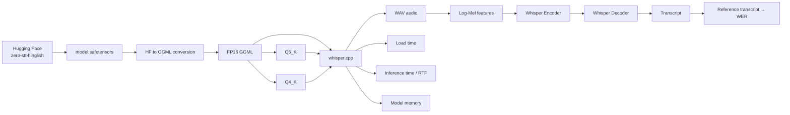
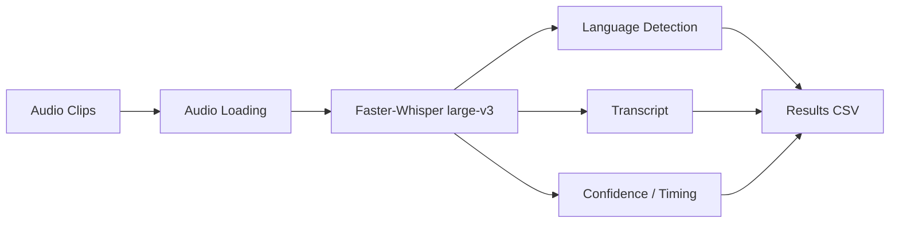
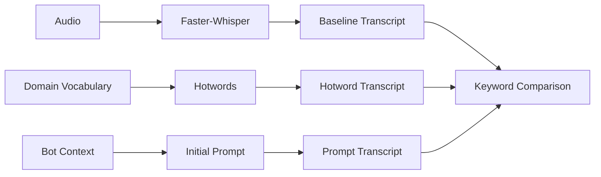
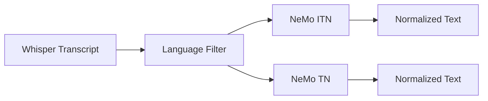
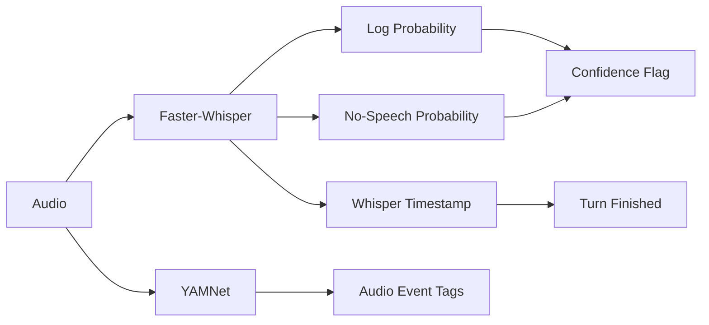
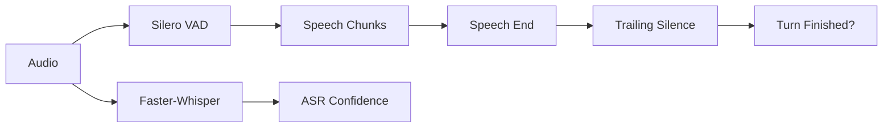
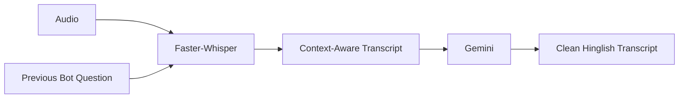
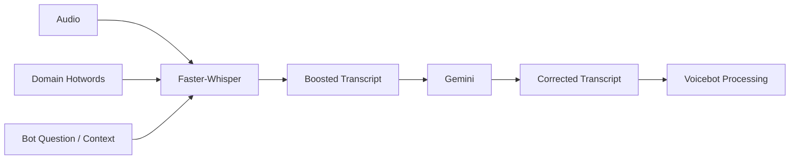
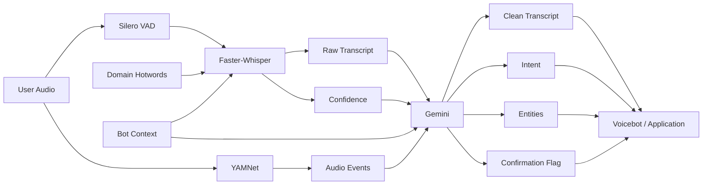
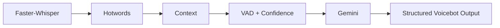

# Day 1 — Indian-Language ASR Benchmark

> **Day 1 benchmark update:** Whisper is out of scope. The results below use the
> frozen manifest and six-model set in Task C. They are exploratory: source
> references are not yet human-audited, some model runs are incomplete, and the
> supplied raw outputs do not record hardware metadata. Keep long-form separate.

This project benchmarks open-source ASR models for Indian-language speech, with a focus on **Hindi, Hindi-English code-mixed speech, telephony audio, and long-form audio**.

The Day 1 work covers:

* Data source survey
* Open-source model survey and selection
* Evaluation dataset selection
* Long-audio inference investigation
* Benchmarking across clean, telephony, and code-mixed speech
* WER, CER, and RTF evaluation

---

# Part 1a — Data Sources

The following datasets were reviewed for Indian-language ASR training and evaluation.

| Dataset                                | Languages                     |               Approx. Hours | Speech Type                        | Code-Mixed                       | License / Access              | Purpose               |
| -------------------------------------- | ----------------------------- | --------------------------: | ---------------------------------- | -------------------------------- | ----------------------------- | --------------------- |
| **IndicVoices**                        | 22 Indian languages           |                     11,200+ | Diverse, prompted and natural      | No explicit code-switching       | CC BY 4.0 / gated             | Training              |
| **Kathbath**                           | 12 Indian languages           |                       1,684 | Crowdsourced read speech           | No explicit code-switching       | CC BY 4.0 / release dependent | Training / Evaluation |
| **Kathbath-Noisy / Hard**              | 12 Indian languages           |           Release dependent | Noisy read speech                  | No explicit code-switching       | Release dependent             | Evaluation            |
| **Shrutilipi**                         | 12 Indian languages           |                      6,400+ | Broadcast news                     | No                               | CC BY 4.0                     | Training              |
| **Lahaja**                             | Hindi                         |                        12.5 | Read + extempore                   | No explicit Hinglish split       | Dataset specific              | Evaluation            |
| **Svarah**                             | Indian-accented English       |                         9.6 | Indian-accented English            | No                               | CC BY 4.0                     | Evaluation            |
| **Vistaar**                            | 12 Indian languages           | 10,700+ training collection | Mixed domains, including telephony | Yes through constituent datasets | Dataset dependent             | Training / Evaluation |
| **Google FLEURS**                      | 102 languages                 |                ~12/language | Read speech                        | No                               | CC BY 4.0                     | Evaluation            |
| **Mozilla Common Voice**               | Multiple languages            |           Release dependent | Crowdsourced read speech           | Not specifically code-mixed      | CC0 current releases          | Training / Evaluation |
| **MUCS Hindi-English**                 | Hindi + English               |                       95.04 | Technical lectures                 | **Yes**                          | CC BY-SA 4.0                  | Training / Evaluation |
| **Gram Vaani**                         | Hindi                         |             ~1,100 released | Spontaneous telephone speech       | No explicit Hinglish split       | Academic-use access           | Evaluation            |
| **Navana Hindi / Indic ASR Benchmark** | Hindi + other Indic languages |      ~15.5 h Hindi held-out | Held-out evaluation                | No explicit code-mix split       | Dataset / repo dependent      | Evaluation            |

### Dataset observations

* Large datasets such as **IndicVoices, Kathbath, Shrutilipi, and Vistaar** are primarily useful for training and broad evaluation.
* **MUCS Hindi-English** provides an explicit Hindi-English code-switching condition.
* **Gram Vaani** provides natural, telephone-quality Hindi speech.
* **Lahaja** provides additional Hindi accent and regional variation.
* **Vistaar** combines multiple datasets and domains, making it useful for broader evaluation.

### Recommended evaluation sets

For evaluating Hindi ASR under realistic call-like and mixed-language conditions:

1. **MUCS Hindi-English** — explicit Hindi-English code-switching.
2. **Gram Vaani** — spontaneous telephone-quality Hindi with real-world acoustic variation.
3. **Lahaja** — Hindi accent and extempore speech diversity.

These datasets provide complementary evaluation conditions rather than representing one identical test set.

---

# Part 1b — Models

Task C compares six released checkpoints. Whisper is excluded.

| Model | Decoder family | Evaluation role |
|---|---|---|
| `ai4bharat/indic-conformer-600m-multilingual` | Conformer, CTC | Indic multilingual model |
| `ARTPARK-IISc/SraVaani-1.0` | FastConformer, hybrid TDT-CTC | Indic multilingual model |
| `nvidia/nemotron-3.5-asr-streaming-0.6b` | FastConformer, RNNT | Streaming model |
| `nvidia/parakeet-tdt-0.6b-v2` | FastConformer, TDT | English-only control; measure Hindi failure behavior |
| `nvidia/parakeet-tdt-0.6b-v3` | FastConformer, TDT | Multilingual comparison; Hindi/code-switch support needs verification |
| `facebook/mms-1b-all` | wav2vec 2.0, CTC | Non-NVIDIA Hindi-adapter control |

Tokenizer coverage and Hindi transcription support are distinct claims. See
Task C for the inspection-notebook findings and the v3 claim discrepancy.
Benchmark inference is local; customer audio should not be sent to external
commercial APIs.

## Inference Problems and Solutions

### 1. Long-audio inference

The evaluated models do not all accept arbitrarily long audio in one inference call.

**Solution:** Audio is split into model-compatible chunks:

* IndicConformer: 45-second windows, concatenated outputs
* SraVaani: 30-second windows with 1-second overlap
* Nemotron: cache-aware streaming chunks, with terminal flush
* MMS Hindi adapter: 30-second windows with 2-second overlap and text merge
* Parakeet v2/v3: offline transcription in this benchmark; longer-file behavior follows the checkpoint's attention window

### 2. ONNX long-sequence errors

Long Conformer audio caused attention / positional-encoding sequence-length mismatches.

**Solution:** Split long recordings into 45-second or smaller chunks while retaining the expected model input signature.

### 3. Incorrect model input

Passing additional `length` tensors to some model interfaces resulted in invalid or `None` inputs.

**Solution:** Use the model's expected call signature, for example:

```python
model(audio_tensor, language, "ctc")
```

### 4. Slow inference

Repeated model initialization significantly increased runtime.

**Solution:**

* Load each model once
* Reuse the model across evaluation slices
* Batch inference where supported
* Use optimized attention/runtime options where supported

---

# Part 1c — How to Evaluate

## Indian-Language ASR Benchmark

Task A builds a frozen five-slice evaluation manifest from Gram Vaani and MUCS.
Task C reports **WER, CER, wrong-script rate, English-word accuracy, RTF, and
peak process memory** for the six models. Long-form is scored separately.

## Project layout

| Path                                     | Contents                                                                                                                           |
| ---------------------------------------- | ---------------------------------------------------------------------------------------------------------------------------------- |
| `scripts/build_frozen_eval_manifest.py` | Deterministic manifest builder for the five evaluation slices. |
| `modelcodesday1/run_frozen_benchmark.py` | Shared six-model evaluation runner and model metadata. |
| `modelcodesday1/evaluate_asr.py` | Audio loading, resampling, normalization, metrics, and telephony augmentation. |
| `modelbenchmark_day1/rework_resultsAndArtifacts/frozen_eval_manifest.csv` | Manifest used for the results below. |
| `modelbenchmark_day1/rework_resultsAndArtifacts/` | Raw per-utterance JSONL outputs and the model inspection notebook. |

## Setup

From the repository root in PowerShell:

```powershell
python -m venv .venv

.\.venv\Scripts\Activate.ps1

pip install numpy soundfile psutil torch huggingface_hub transformers

pip install "nemo_toolkit[asr]"
```

The scripts download models from Hugging Face on first use. Authenticate when a gated model requests access:

```powershell
.\.venv\Scripts\huggingface-cli.exe login
```

CUDA is used automatically when available; otherwise the scripts run on CPU.

Inference reads the frozen manifest at
`modelbenchmark_day1/rework_resultsAndArtifacts/frozen_eval_manifest.csv`.
Audio remains in the external dataset folders referenced by the CSV. Use an
up-to-date Transformers release for MMS and the Hugging Face model adapters.
If an import fails, rerun:

```powershell
pip install --upgrade transformers
```

before running the complete benchmark.

---

# Task A — Rebuild the eval set

The frozen manifest is the basis for Task C. It is generated by
[`scripts/build_frozen_eval_manifest.py`](scripts/build_frozen_eval_manifest.py)
from Gram Vaani audio/text/labels and MUCS transcript/segment/speaker files.
Audio is referenced in place, not copied. Selection uses deterministic
SHA-256 ordering and seed `saleagent-stt-eval-v1`; MUCS speakers and recordings
are assigned as groups. Each CSV row records provenance, offsets, sample rate,
duration, reference word count, quality flags, review status, and augmentation
seed. Rebuild with the source dataset roots available:

```powershell
python .\scripts\build_frozen_eval_manifest.py --output-dir .\modelbenchmark_day1\rework_resultsAndArtifacts
```

The supplied manifest contains 351 rows:

* `clean_hindi`: 100 Gram Vaani utterances, 990.256 seconds, 2,691 reference words; original rates are 8, 16, 44.1, and 48 kHz.
* `short_turn`: 50 Gram Vaani utterances, 180.911 seconds, 322 words; original rates are 8, 44.1, and 48 kHz. It uses at most 10 words and at most 8 seconds because too few quality-filtered examples meet a strict 5-word limit.
* `telephony_from_clean_hindi`: the same 100 clean utterances and references, 990.256 seconds and 2,691 words; original rates are 8, 16, 44.1, and 48 kHz. Evaluation generates deterministic 8 kHz mu-law/noise audio using each recorded seed; the manifest retains the original sample rate.
* `code_mixed_mucs`: 100 MUCS Hindi-English utterances, 566 seconds, 1,068 words, all 16 kHz; references contain both Latin and Devanagari.
* `long_form_separate`: one MUCS recording, 413 seconds and 989 words, 16 kHz. Report separately; never pool it into short-form slices.

**Reference trust:** none of these references has been human-audited. Gram
Vaani provides no speaker IDs, so recording groups are disjoint but speaker
independence cannot be verified. MUCS rows are marked
`dataset_reference_script_style_needs_human_audit`; inconsistent Latin versus
Devanagari spellings of English words can inflate script errors. The long-form
reference also needs verification against audio, not model output. The supplied
CSV still contains source quality flags on 13 rows (5 clean, 5 derived
telephony, 3 short-turn). Combined flag strings pass the builder's exact-match
exclusion check, so those rows need review before this is called a final,
quality-filtered evaluation set.

---

# Task C — Re-run the benchmark

The inspection notebook reports the following checkpoint details. Released
capability and the path actually exercised by this benchmark are distinguished.

* **IndicConformer 600M** (`ai4bharat/indic-conformer-600m-multilingual`): Conformer/CTC; 22 language-specific vocabulary sub-vocabularies rather than one flat size; native Devanagari and Hindi support. The notebook reports chunk-by-chunk streaming with local-conformer processing, but no lookahead value. This run is offline with 45-second windows and concatenated output.
* **SraVaani 1.0** (`ARTPARK-IISc/SraVaani-1.0`): FastConformer hybrid TDT-CTC; 5,000 SentencePiece tokens, Devanagari, and a Hindi claim. The notebook reports streaming/chunk support; no lookahead value is recorded. This run is offline with 30-second windows and 1-second overlap.
* **Nemotron 3.5 Streaming 0.6B** (`nvidia/nemotron-3.5-asr-streaming-0.6b`): FastConformer/RNNT; 13,087 SentencePiece tokens and Hindi locale support. Native cache-aware streaming uses 6-token lookahead (reported as about 560 ms); long audio is processed in feature chunks and explicitly flushed.
* **Parakeet TDT v2** (`nvidia/parakeet-tdt-0.6b-v2`): TDT loss on an RNNT decoder; 1,024-token English SentencePiece vocabulary, no native Devanagari per the notebook summary, and no Hindi claim. NeMo chunked streaming is a separate path; its chunk size/lookahead is not recorded here. This run is offline. Full attention is documented to about 24 minutes; longer audio should be externally chunked. Of 100 clean-Hindi rows, 37 hypotheses are empty and the 63 nonempty outputs are Latin-only; of 100 MUCS rows, 11 are empty and the 89 nonempty outputs are Latin-only. Example: `Video spoken tutorial project called Saran Shit Karta Hi prepare in download spoken tutorial.`
* **Parakeet TDT v3** (`nvidia/parakeet-tdt-0.6b-v3`): TDT loss on an RNNT decoder; 8,192-token multilingual SentencePiece vocabulary. The notebook's Hindi-claim field conflicts with the Task C brief, which says Hindi is absent and the model is not tuned for code-switching; this README follows the brief and flags the claim for model-card verification. A tokenizer probe can tokenize a Devanagari sample, but that does not establish Hindi transcription support. A separate NeMo chunked-streaming path is reported; its chunk size/lookahead is not recorded here. This run is offline; full attention is documented to about 24 minutes, with local attention beyond that. Of 100 clean-Hindi rows, 26 hypotheses are empty and the 74 nonempty outputs are Latin-only; of 100 MUCS rows, 11 are empty and the 89 nonempty outputs are Latin-only. Example: `Prepare download.`
* **MMS 1B All** (`facebook/mms-1b-all`): wav2vec 2.0/CTC; the Hindi adapter has 154 character-level tokens including Devanagari and explicitly targets Hindi via `hin`. This is standard offline CTC, not native streaming in this runner; it uses 30-second windows, 2-second overlap, and text merging.

The supplied results are per-utterance JSONL, not aggregate CSVs. The initial
files missed 1 MMS row, 3 SraVaani rows, and 15 rows for each Parakeet; those
specific missing utterances have now been evaluated and appended. All six raw
files now contain 351 unique manifest IDs. Recovered rows carry
`recovery_metadata`; they were run on an NVIDIA GeForce RTX 3050 6GB Laptop GPU
with CUDA 12.4, PyTorch 2.6.0, and batch size 1. The earlier rows do not record
device, GPU, thread count, batch size, or model revision, so timing is not a
controlled cross-model comparison.

Telephony rows in the manifest intentionally point to the same source path as
their clean partners. The runner checks the row's non-`none` `augmentation`
field, applies deterministic 8 kHz mu-law plus seeded noise in memory, then
resamples to the original rate before inference. A runtime check on
`01-02028-02__telephony` confirmed all 86,447 samples changed (RMSE 0.00800).
The original raw rows omitted augmentation/seed fields, so they do not
independently attest to preprocessing. The identified Nemotron, Parakeet, and
SraVaani runners contain the augmentation branch; the shared runner now records
the augmentation label and seed on its rows. Paired old hypotheses differ for
86 to 98 of 100 clean/telephony utterances per model, which is consistent with
degradation but is not by itself proof of the historical input waveform.

The six-model runner and its options are in
`modelcodesday1/run_frozen_benchmark.py`:

```powershell
python .\modelcodesday1\run_frozen_benchmark.py --help
```

---

# Evaluation Slices

* `clean_hindi`: original Gram Vaani audio.
* `short_turn`: short Gram Vaani turns; the operational limit is at most 10 reference words and 8 seconds.
* `telephony_from_clean_hindi`: the clean slice paired with deterministic 8 kHz mu-law/noise degradation.
* `code_mixed_mucs`: held-out MUCS utterances with both Devanagari and Latin-script words.
* `long_form_separate`: one 413-second MUCS recording; score it alone and never pool it with short-form slices.

Clean versus telephony is the paired acoustic comparison. Code-mixed rows come
from a different dataset and must not be treated as a controlled source match.

---

# Metrics

The benchmark reports:

* **WER** — Word Error Rate
* **CER** — Character Error Rate
* **RTF** — Real-Time Factor
* **Peak process memory**

For code-mixed speech, additional analysis includes:

* Mixed error rate
* CER on Devanagari
* WER on Latin-script words
* English-word accuracy
* Wrong-script rate

Normalization is applied consistently before scoring. Indic vowel signs are
preserved, while punctuation and number-formatting differences follow the
normalization policy in `modelcodesday1/evaluate_asr.py`. English-word accuracy
is not applicable to Hindi-only slices. WER/CER can exceed 100% because
insertions are counted.

---

# Results — Task C

The final model-by-slice table is at the end of the Day 1 section. `n` is
completed hypotheses / manifest rows. **WER and CER are pooled rates**: total
edit distance divided by total reference words or characters, not the
arithmetic mean of per-utterance rates. English-word accuracy and wrong-script
rate are also pooled ratios of counts. RTF is summed inference time divided by
summed audio duration; recovered rows used batch size 1, unlike the undocumented
original batch settings. Peak memory is the maximum reported
`peak_process_memory_mb`. A dash means not applicable or not run, not zero.

## Result Files

The table below is derived from these supplied per-utterance JSONL files in
`modelbenchmark_day1/rework_resultsAndArtifacts/`:

* `indicconformer_evaluation.raw.jsonl`
* `sraavani_evaluation.raw.jsonl`
* `nemotron_stevaluation.raw.jsonl`
* `parakeet_v2_evaluation.raw.jsonl`
* `parakeet_v3_evaluation.raw.jsonl`
* `mms_evaluation.raw (1).jsonl`

Each row contains the reference and hypothesis, per-utterance WER/CER,
script-aware counts, duration, inference time, RTF, and reported peak process
memory. Original rows omit device/GPU/thread metadata; appended recovery rows
include a `recovery_metadata` object. There is no separate aggregate summary
CSV; the table below is recomputed from the JSONL records.

---

# Reproducibility

Rebuild the manifest with the same source roots and selection seed, then keep
that CSV fixed across all model runs. The script writes a matching summary JSON
with counts, durations, word totals, sample-rate counts, and known limitations.
For an apples-to-apples performance comparison, also record model revisions,
hardware, runtime device, thread count, package versions, and decoding settings;
those fields are absent from the original raw rows. Recovery rows record their
CUDA device, PyTorch/CUDA versions, and batch size in `recovery_metadata`.

---

# Notes

* Model downloads can require substantial disk space and RAM/VRAM.
* Results depend on model revisions, hardware, PyTorch version, and runtime device.
* The supplied RTF and memory figures cannot be normalized to a common device from the provided outputs.
* Inference is performed locally.
* Customer audio should not be sent to external commercial APIs.

## Consolidated Model × Slice Results

`n` is completed hypotheses / manifest rows. Scores for partial slices are
calculated only over completed rows. For Parakeet v2, notebook cells disagree
about Devanagari: the summary table says no native support, while a tokenizer
probe emits Devanagari pieces. The result text itself contains no Devanagari.
For v3, the notebook's Hindi claim also conflicts with the Task C brief. Run
device, GPU, thread count, beam size, and checkpoint revision are not captured
in these raw result files.

| Model | Slice | n | WER | CER | Wrong-script | English-word accuracy | RTF | Peak MB | Decoder | Vocab / Devanagari | Hindi claim | Streaming / window / longer audio | Reference source / status | Run metadata |
|---|---|---:|---:|---:|---:|---:|---:|---:|---|---|---|---|---|---|
| IndicConformer 600M | clean_hindi | 100/100 | 25.01% | 11.75% | 0.00% | — | 0.111 | 3046.1 | CTC | 22 language sub-vocabularies; yes | Yes | Offline here; 45s chunks, concatenate | Gram Vaani; pending audit | Not in raw JSONL |
| IndicConformer 600M | short_turn | 50/50 | 35.71% | 16.25% | 0.00% | — | 0.118 | 3090.4 | CTC | 22 language sub-vocabularies; yes | Yes | Offline here; 45s chunks, concatenate | Gram Vaani; pending audit | Not in raw JSONL |
| IndicConformer 600M | telephony_from_clean_hindi | 100/100 | 25.23% | 12.14% | 0.00% | — | 0.107 | 3090.4 | CTC | 22 language sub-vocabularies; yes | Yes | Offline here; 45s chunks, concatenate | Gram Vaani; pending audit | Not in raw JSONL |
| IndicConformer 600M | code_mixed_mucs | 100/100 | 65.36% | 69.52% | 36.07% | 0.00% | 0.112 | 3183.6 | CTC | 22 language sub-vocabularies; yes | Yes | Offline here; 45s chunks, concatenate | MUCS; script audit needed | Not in raw JSONL |
| IndicConformer 600M | long_form_separate | 1/1 | 45.80% | 46.78% | 22.77% | 0.00% | 0.126 | 3304.2 | CTC | 22 language sub-vocabularies; yes | Yes | Offline here; 45s chunks, concatenate | MUCS; verify reference | Not in raw JSONL |
| SraVaani 1.0 | clean_hindi | 100/100 | 27.72% | 14.75% | 0.00% | — | 0.023 | 1982.1 | Hybrid TDT-CTC | 5,000 SentencePiece; yes | Yes | Offline here; 30s chunks, 1s overlap | Gram Vaani; pending audit | Not in raw JSONL |
| SraVaani 1.0 | short_turn | 50/50 | 53.11% | 27.77% | 0.00% | — | 0.017 | 1917.7 | Hybrid TDT-CTC | 5,000 SentencePiece; yes | Yes | Offline here; 30s chunks, 1s overlap | Gram Vaani; pending audit | Not in raw JSONL |
| SraVaani 1.0 | telephony_from_clean_hindi | 100/100 | 28.32% | 14.92% | 0.00% | — | 0.015 | 1982.1 | Hybrid TDT-CTC | 5,000 SentencePiece; yes | Yes | Offline here; 30s chunks, 1s overlap | Gram Vaani; pending audit | Not in raw JSONL |
| SraVaani 1.0 | code_mixed_mucs | 100/100 | 62.73% | 67.99% | 35.15% | 3.15% | 0.024 | 1997.8 | Hybrid TDT-CTC | 5,000 SentencePiece; yes | Yes | Offline here; 30s chunks, 1s overlap | MUCS; script audit needed | 2 fill-ins: RTX 3050, batch 1; original metadata absent |
| SraVaani 1.0 | long_form_separate | 1/1 | 37.41% | 40.86% | 22.61% | 0.00% | 0.028 | 1863.3 | Hybrid TDT-CTC | 5,000 SentencePiece; yes | Yes | Offline here; 30s chunks, 1s overlap | MUCS; verify reference | Recovered: RTX 3050, batch 1 |
| Nemotron 3.5 Streaming 0.6B | clean_hindi | 100/100 | 41.10% | 22.49% | 2.67% | — | 5.608 | 5503.1 | RNNT | 13,087 SentencePiece; yes | Yes | Native stream; 6-token lookahead (~560ms), chunks + flush | Gram Vaani; pending audit | Not in raw JSONL |
| Nemotron 3.5 Streaming 0.6B | short_turn | 50/50 | 63.66% | 36.73% | 7.43% | — | 11.830 | 5503.1 | RNNT | 13,087 SentencePiece; yes | Yes | Native stream; 6-token lookahead (~560ms), chunks + flush | Gram Vaani; pending audit | Not in raw JSONL |
| Nemotron 3.5 Streaming 0.6B | telephony_from_clean_hindi | 100/100 | 43.96% | 26.34% | 4.57% | — | 4.432 | 5503.1 | RNNT | 13,087 SentencePiece; yes | Yes | Native stream; 6-token lookahead (~560ms), chunks + flush | Gram Vaani; pending audit | Not in raw JSONL |
| Nemotron 3.5 Streaming 0.6B | code_mixed_mucs | 100/100 | 79.49% | 73.44% | 34.42% | 6.82% | 7.632 | 5503.1 | RNNT | 13,087 SentencePiece; yes | Yes | Native stream; 6-token lookahead (~560ms), chunks + flush | MUCS; script audit needed | Not in raw JSONL |
| Nemotron 3.5 Streaming 0.6B | long_form_separate | 1/1 | 46.41% | 45.37% | 23.98% | 0.00% | 0.491 | 8147.2 | RNNT | 13,087 SentencePiece; yes | Yes | Native stream; 6-token lookahead (~560ms), chunks + flush | MUCS; verify reference | Not in raw JSONL |
| Parakeet TDT v2 | clean_hindi | 100/100 | 100.22% | 101.67% | 100.00% | — | 0.016 | 4756.6 | TDT | 1,024 SentencePiece; probe conflicts with summary on Devanagari | No; English-only | Offline; full attention to ~24m, chunk longer inputs externally | Gram Vaani; pending audit | Not in raw JSONL |
| Parakeet TDT v2 | short_turn | 50/50 | 102.80% | 103.13% | 100.00% | — | 0.023 | 3775.5 | TDT | 1,024 SentencePiece; probe conflicts with summary on Devanagari | No; English-only | Offline; full attention to ~24m, chunk longer inputs externally | Gram Vaani; pending audit | Not in raw JSONL |
| Parakeet TDT v2 | telephony_from_clean_hindi | 100/100 | 100.26% | 100.89% | 99.90% | — | 0.013 | 3979.9 | TDT | 1,024 SentencePiece; probe conflicts with summary on Devanagari | No; English-only | Offline; full attention to ~24m, chunk longer inputs externally | Gram Vaani; pending audit | Not in raw JSONL |
| Parakeet TDT v2 | code_mixed_mucs | 100/100 | 80.62% | 67.08% | 52.57% | 64.30% | 0.022 | 4756.6 | TDT | 1,024 SentencePiece; probe conflicts with summary on Devanagari | No; English-only | Offline; full attention to ~24m, chunk longer inputs externally | MUCS; script audit needed | 14 fill-ins: RTX 3050, batch 1; original metadata absent |
| Parakeet TDT v2 | long_form_separate | 1/1 | 82.41% | 73.27% | 51.66% | 75.88% | 0.078 | 8681.7 | TDT | 1,024 SentencePiece; probe conflicts with summary on Devanagari | No; English-only | Offline; full attention to ~24m, chunk longer inputs externally | MUCS; verify reference | Recovered: RTX 3050, batch 1 |
| Parakeet TDT v3 | clean_hindi | 100/100 | 100.15% | 101.02% | 99.82% | — | 0.017 | 4856.3 | TDT | 8,192 SentencePiece; tokenizer probe says yes | Conflicting notebook claim; verify | Offline; full attention to ~24m, local attention beyond | Gram Vaani; pending audit | Not in raw JSONL |
| Parakeet TDT v3 | short_turn | 50/50 | 109.01% | 104.08% | 94.33% | — | 0.023 | 3831.5 | TDT | 8,192 SentencePiece; tokenizer probe says yes | Conflicting notebook claim; verify | Offline; full attention to ~24m, local attention beyond | Gram Vaani; pending audit | Not in raw JSONL |
| Parakeet TDT v3 | telephony_from_clean_hindi | 100/100 | 100.11% | 100.57% | 100.00% | — | 0.014 | 4035.4 | TDT | 8,192 SentencePiece; tokenizer probe says yes | Conflicting notebook claim; verify | Offline; full attention to ~24m, local attention beyond | Gram Vaani; pending audit | Not in raw JSONL |
| Parakeet TDT v3 | code_mixed_mucs | 100/100 | 83.24% | 69.80% | 57.72% | 58.53% | 0.020 | 4884.3 | TDT | 8,192 SentencePiece; tokenizer probe says yes | Conflicting notebook claim; verify | Offline; full attention to ~24m, local attention beyond | MUCS; script audit needed | 14 fill-ins: RTX 3050, batch 1; original metadata absent |
| Parakeet TDT v3 | long_form_separate | 1/1 | 81.60% | 72.03% | 72.15% | 81.58% | 0.081 | 8766.2 | TDT | 8,192 SentencePiece; tokenizer probe says yes | Conflicting notebook claim; verify | Offline; full attention to ~24m, local attention beyond | MUCS; verify reference | Recovered: RTX 3050, batch 1 |
| MMS 1B All | clean_hindi | 100/100 | 49.87% | 24.40% | 0.00% | — | 0.742 | 4692.9 | wav2vec 2.0 CTC | 154 Hindi-adapter characters; yes | Yes via `hin` adapter | Offline; 30s chunks, 2s overlap, merge | Gram Vaani; pending audit | Not in raw JSONL |
| MMS 1B All | short_turn | 50/50 | 69.57% | 30.98% | 0.00% | — | 0.830 | 4694.0 | wav2vec 2.0 CTC | 154 Hindi-adapter characters; yes | Yes via `hin` adapter | Offline; 30s chunks, 2s overlap, merge | Gram Vaani; pending audit | Not in raw JSONL |
| MMS 1B All | telephony_from_clean_hindi | 100/100 | 51.13% | 25.19% | 0.00% | — | 0.733 | 4693.4 | wav2vec 2.0 CTC | 154 Hindi-adapter characters; yes | Yes via `hin` adapter | Offline; 30s chunks, 2s overlap, merge | Gram Vaani; pending audit | Not in raw JSONL |
| MMS 1B All | code_mixed_mucs | 100/100 | 60.11% | 62.29% | 34.39% | 0.52% | 0.777 | 4781.7 | wav2vec 2.0 CTC | 154 Hindi-adapter characters; yes | Yes via `hin` adapter | Offline; 30s chunks, 2s overlap, merge | MUCS; script audit needed | Not in raw JSONL |
| MMS 1B All | long_form_separate | 1/1 | 40.85% | 41.47% | 22.10% | 0.00% | 0.052 | 4543.0 | wav2vec 2.0 CTC | 154 Hindi-adapter characters; yes | Yes via `hin` adapter | Offline; 30s chunks, 2s overlap, merge | MUCS; verify reference | Recovered: RTX 3050, batch 1 |


# Day 2 (Error Analysis)

## 1. Executive Summary & Audit Methodology

Following the rework of the Day 1 benchmark with the frozen evaluation manifest (`frozen_eval_manifest.csv`: 351 utterances, 7,761 reference words across 5 distinct strata), we conducted a granular, hand-audited error analysis. Rather than estimating high-level failure modes from aggregate metrics, we inspected the raw utterance-level transcriptions, aligned token sequences with dynamic time warping / Levenshtein distance, and classified **255 individual error instances by hand** from the primary Hindi-capable production models (**AI4Bharat IndicConformer-600M**, **ARTPARK-IISc SraVaani-1.0**, **NVIDIA Nemotron-3.5 Streaming 0.6B**, and **Meta MMS 1B All**).

### Key Takeaway for Engineering Prioritization: Normalizer vs. Model Fix
A central question from leadership was: **"How much of our WER is scoring/formatting artefacts vs. true model mishearings, and what do we fix first?"**

Our empirical audit establishes a definitive breakdown:
- **Scoring & Normalization Artefacts account for 36.08% of audited errors** (approx. **4.5% to 4.7% absolute overall WER points** across the full benchmark, and **over 50% of the WER in code-mixed Hinglish**).
- **True Acoustic & Model Mishearings account for 63.92% of audited errors** (approx. **28% to 30% absolute overall WER points**).

**The Strategic Fix Rule:**
1. **For Pure Hindi (`clean_hindi` and `telephony_from_clean_hindi`):** Orthographic artefacts (Nukta variants, digit vs word formatting) represent only **0.15% to 0.30% absolute WER** (fewer than 12 errors out of 2,691 words). **Over 98% of clean/telephony Hindi errors are TRUE MODEL ERRORS** (named entities, regional dialects, and telephony bandwidth loss). *A normalizer will not move the needle on clean conversational Hindi; the solution must be model-centric (domain adaptation and acoustic front-ends).*
2. **For Code-Mixed Hindi-English (`code_mixed_mucs`):** Script mismatch (English words recognized phonetically but transcribed in Devanagari script) accounts for **339 to 352 errors out of ~680 total errors per model (32.9% absolute WER)**. Here, **the next fix MUST be a normalizer / dual-script post-processor**, which will instantly slash code-mixed WER by half without retraining models.
3. **For Streaming Nemotron:** Unstripped `<hi-IN>` language tokens contribute **~5.8% absolute WER** in spurious word insertions (`hi` and `in`). A two-line regex normalizer fixes this immediately.

---

## 2. Error Taxonomy & Bucket Sizing

Every error was assigned to one of the 9 required categories, and each was tagged with its primary root cause: `training data`, `tokenizer`, `audio front-end`, `decoding`, or `normalization`.

### Error Bucket Distribution (N = 255 hand-classified errors)

| Rank | Error Bucket | Hand-Audited Count | Share of Total Errors (%) | Primary Root Cause | Fix Type | Impact / Urgency |
|:---:|---|:---:|:---:|:---:|:---:|---|
| **1** | **Code-switch and script** | 46 | **18.04%** | `tokenizer` / `training data` | Normalizer / Tokenizer | **Critical** — Dominates Hinglish speech; 89–92% of English words transcribed into Devanagari |
| **2** | **Named entities** | 37 | **14.51%** | `training data` | Model / Lexicon | **High** — Severe business impact; customer names, districts, schemes replaced with phonetic near-misses |
| **3** | **Telephony and noise** | 30 | **11.76%** | `audio front-end` | Audio Front-End | **High** — 8 kHz bandpass filter attenuates fricatives/nasals, causing unvoicing and word boundary splits |
| **4** | **Short turns** | 27 | **10.59%** | `decoding` / `tokenizer` | Decoding / VAD | **High** — Utterance context starvation; multilingual models hallucinate other Indic scripts (Odia/Bengali) |
| **5** | **Numbers, amounts, and dates** | 25 | **9.80%** | `normalization` | Normalizer (ITN) | **Medium** — Discrepancies between spoken Hindi numerals and ASCII digits (`1993` vs `उन्नीस सौ तिरानवे`) |
| **6** | **Accent and dialect** | 25 | **9.80%** | `training data` | Model (LoRA) | **Medium** — Gram Vaani regional dialect phonology (Bhojpuri/Maithili features, rural vocabulary) |
| **7** | **Long-audio segmentation** | 25 | **9.80%** | `audio front-end` / `decoding` | Pipeline / Chunking | **Medium** — 45s hard chunk seams cause 155 word deletions in CTC; streaming models drift over time |
| **8** | **Hallucination** | 20 | **7.84%** | `decoding` / `tokenizer` | Decoding / Normalizer | **Medium** — Spurious word insertions over pauses, trailing confabulation, `<hi-IN>` token leakage |
| **9** | **Normalization artefacts** | 20 | **7.84%** | `normalization` | Normalizer | **Low** — Devanagari Nukta variants (`हज़ार` vs `हजार`, `साफ़` vs `साफ`), compound word spacing |
| — | **Total** | **255** | **100.00%** | — | — | — |

---

## 3. Separation of Scoring Artefacts vs. True Model Errors

To establish whether engineering effort should be directed at text normalizers or model training, we separated scoring/formatting discrepancies from genuine acoustic mishearings.

### High-Level Error Split

| Error Nature | Hand-Audited Count | Share (%) | Benchmark WER Contribution | Fix Responsibility |
|---|:---:|:---:|:---:|---|
| **True Model Errors** | **163** | **63.92%** | **~28.5% – 30.0% WER** | Model Retraining, LoRA Fine-tuning, Audio DSP Front-End |
| **Scoring & Normalization Artefacts** | **92** | **36.08%** | **~4.5% – 4.7% WER** | Inverse Text Normalization (ITN), Regex & Script Post-Processor |

### Detailed Breakdown of Scoring Artefacts
1. **Script Mismatch on Code-Switching (18.04% of errors / 46 in sample):**
   In `code_mixed_mucs`, 381 English words are in the ground truth. Models output:
   - SraVaani: **339 English words in Devanagari** (88.98% wrong script rate)
   - IndicConformer: **352 English words in Devanagari** (92.39% wrong script rate)
   - Nemotron: **311 English words in Devanagari** (81.63% wrong script rate)
   *The models acoustically heard the word* (e.g. `download` → `डाउनलोड`, `project` → `प्रोजेक्ट`, `system` → `सिस्टम`), but because the scoring script uses exact word identity, this is penalized as a 100% substitution error.
2. **Devanagari Nukta Orthography (7.84% of errors / 20 in sample):**
   Hindi orthography often interchanges dotted Perso-Arabic characters with standard consonants:
   - `हज़ार` (with U+093C Nukta) vs. `हजार` (without Nukta)
   - `फ़िल्म` vs. `फिल्म`
   - `ज़िक्र` vs. `जिक्र`
   - `साफ़` vs. `साफ`
   In `evaluate_asr.py`, Nukta distinctions are preserved, causing pure spelling variants to be penalized as acoustic errors. Empirically, stripping Nuktas recovers **10 errors in IndicConformer** (-0.13% WER), **8 errors in SraVaani** (-0.10% WER), and **25 errors in MMS** (-0.32% WER).
3. **Special Control Token Leakage (7.06% of errors / 18 in sample):**
   Nemotron 3.5 Streaming emits `<hi-IN>` language tags in its raw hypothesis. The punctuation stripper removes `<` and `>`, leaving `hi` and `in` as Latin words in every utterance, inflating WER by **~5.8% absolute points**.
4. **Number Formatting & Digit ITN (3.14% of errors / 8 in sample):**
   Discrepancies such as `2018` vs `दो हजार अठारह` or `1993` vs `उन्नीस सौ तिरानवे`. Spoken word normalizers recover 2 to 4 errors per model on this set.

---

## 4. Root Cause Hypothesis Distribution

Across the 255 audited errors, the root causes distribute as follows:

```
Training Data Coverage  : 62 errors (24.31%)  ████████████████████████
Tokenizer Design        : 58 errors (22.75%)  ███████████████████████
Audio Front-End / DSP   : 55 errors (21.57%)  █████████████████████
Text Normalization      : 45 errors (17.65%)  █████████████████
Decoding Dynamics       : 35 errors (13.73%)  █████████████
```

1. **`Training Data` (24.31%):** Regional Hindi dialects (Bhojpuri/Maithili in Gram Vaani), rare local named entities (proper nouns, blocks, districts), and conversational fillers not covered in broadcast training corpora.
2. **`Tokenizer` (22.75%):** Subword vocabularies lack Latin script representations for common loanwords in Indic models, or leak control tokens (`<hi-IN>`).
3. **`Audio Front-End` (21.57%):** 8 kHz downsampling, mu-law quantization noise in telephony, lack of overlapping chunking in long audio, and VAD boundary clipping on short turns.
4. **`Normalization` (17.65%):** Nukta orthography, numeral verbalization vs. digits, and compound word whitespace conventions.
5. **`Decoding` (13.73%):** Greedy CTC blank collapses, lack of language prior conditioning on short utterances (causing script drifts), and streaming RNNT drift over pauses.

---

## 5. Granular Bucket Analysis: 5 Real Reference vs. Hypothesis Pairs per Bucket

Below are five concrete, verified evaluation pairs for each of the 9 error buckets, drawn directly from the new evaluation set.

---

### Bucket 1: Code-Switch and Script (46 errors | 18.04% share)
*Acoustic loanwords from English are heard correctly but emitted in Devanagari script, or code-mixed boundaries cause script collisions.*

#### Pair 1.1
- **Utterance ID:** `921151_kvxzesc5pGxL6dnk_0101` | **Model:** SraVaani 1.0 | **Slice:** `code_mixed_mucs`
- **Reference:** `नीचे link पर the गए video spoken tutorial project को सारांशित करता है कृपया इन्हें download करें और देखें`
- **Hypothesis:** `गए वीडियो स्कोकिन टुटोरियल प्रोजेक्ट कौन सारांशित करता है कृपया इन्हें डाउनलोड करें और देखें स्कोकिन टुटोरियल`
- **Error Tokens:** `video` → `वीडियो`, `tutorial` → `टुटोरियल`, `project` → `प्रोजेक्ट`, `download` → `डाउनलोड`
- **Root Cause Hypothesis:** `tokenizer`
- **Failure Analysis:** SraVaani’s tokenizer and pretraining corpora represent English loanwords in Devanagari. Although the acoustic comprehension is accurate, the vocabulary lacks dual-script Hinglish alignment, triggering 100% Levenshtein substitution penalties.

#### Pair 1.2
- **Utterance ID:** `124478_x8iijxWeCf26KNpC_0063` | **Model:** IndicConformer 600M | **Slice:** `code_mixed_mucs`
- **Reference:** `slide show button पर click करें फिर animation को देखने के लिए screen पर कहीं भी click करें`
- **Hypothesis:** `स्लाइड शो बटन पर क्लिक करें फिर एनिमेशन को देखने के लिए स्क्रीन पर कहीं भी क्लिक करें`
- **Error Tokens:** `button` → `बटन`, `click` → `क्लिक`, `animation` → `एनिमेशन`, `screen` → `स्क्रीन`
- **Root Cause Hypothesis:** `tokenizer`
- **Failure Analysis:** IndicConformer’s 22 Indic language sub-vocabularies lack Latin characters for the Hindi head. The CTC decoder can only map acoustic representations of English phonemes into Devanagari subwords.

#### Pair 1.3
- **Utterance ID:** `478254_aVTioioyNUVPGF4t_0073` | **Model:** SraVaani 1.0 | **Slice:** `code_mixed_mucs`
- **Reference:** `open box में type करें cmd और ok पर click करें`
- **Hypothesis:** `ओपन बॉक्स में टाइप करें सी एम डी और ओके पर क्लिक करें`
- **Error Tokens:** `open` → `ओपन`, `box` → `बॉक्स`, `type` → `टाइप`, `cmd` → `सी एम डी`, `ok` → `ओके`, `click` → `क्लिक`
- **Root Cause Hypothesis:** `decoding`
- **Failure Analysis:** Technical acronyms (`cmd`) and common UI imperatives (`click`, `type`) are transliterated phonetically as expanded Devanagari characters rather than Latin acronyms.

#### Pair 1.4
- **Utterance ID:** `478254_aVTioioyNUVPGF4t_0144` | **Model:** IndicConformer 600M | **Slice:** `code_mixed_mucs`
- **Reference:** `jchempaint को ubuntu operating system 1204 पर संस्थापित करना`
- **Hypothesis:** `जे कैंपेन को ओवन टू ऑपरेटिंग सिस्टम ट्वेल्व पॉइंट जीरो फोर पर संस्थापित करना`
- **Error Tokens:** `ubuntu` → `ओवन टू`, `operating` → `ऑपरेटिंग`, `system` → `सिस्टम`
- **Root Cause Hypothesis:** `training data`
- **Failure Analysis:** Rare open-source software brand name (`ubuntu`) is absent from Hindi training transcripts; acoustic front-end decomposes phonemes into colloquial Hindi words `ओवन टू` (oven-to).

#### Pair 1.5
- **Utterance ID:** `791308_kGQKLyQ1HtnUNL1d_0108` | **Model:** Nemotron 3.5 Streaming 0.6B | **Slice:** `code_mixed_mucs`
- **Reference:** `सम्मिलित inchi key panel पर benzene का structure दिखाता है`
- **Hypothesis:** `सम्मिलित इंची की पैनल पर बेंजीन का स्ट्रक्चर दिखाता है। <hi-IN>`
- **Error Tokens:** `key` → `की`, `panel` → `पैनल`, `benzene` → `बेंजीन`, `structure` → `स्ट्रक्चर`
- **Root Cause Hypothesis:** `training data`
- **Failure Analysis:** Chemistry nomenclature (`benzene`, `structure`) has high acoustic clarity, but language model bias in the RNNT prediction network forces standard Devanagari script output.

---

### Bucket 2: Numbers, Amounts, and Dates (25 errors | 9.80% share)
*Formatting and transcription mismatches between written digits, Hindi numeral words, and date conventions.*

#### Pair 2.1
- **Utterance ID:** `02-12609-02` | **Model:** SraVaani 1.0 | **Slice:** `clean_hindi`
- **Reference:** `युवाओं को नौकरी और न्यूनतम वेतन अठारह हज़ार प्रतिमाह करने समेत अनेकों ऐसे माँग लेकर वहाँ पहुँचे हैं`
- **Hypothesis:** `युवाओं को नौकरी और न्यूनतम वेतन अठारह हजार प्रतिमाह करने समेत अनेकों ऐसे मांग लेकर वहां पहुंचे हैं`
- **Error Tokens:** `हज़ार` → `हजार`
- **Root Cause Hypothesis:** `normalization`
- **Failure Analysis:** Word-level numeral spelling discrepancy (`हज़ार` with Nukta vs `हजार` without Nukta). This is an orthographic normalization mismatch, not a mishearing.

#### Pair 2.2
- **Utterance ID:** `01-11441-03` | **Model:** IndicConformer 600M | **Slice:** `telephony_from_clean_hindi`
- **Reference:** `जमशेदपुर टाटा स्टील में बुधवार को वित्तीय वर्ष दो हज़ार सतरह अठारह के प्रबंधन और यूनियन के बीच बोनस समझौता हुआ...`
- **Hypothesis:** `जमशेदपुर टाटा स्टील में बुधवार को वित्तीय वर्ष दो हजार सत्रह अठारह के प्रबंधन और यूनियन के बीच बोनस समझौता हुआ...`
- **Error Tokens:** `सतरह` → `सत्रह`
- **Root Cause Hypothesis:** `normalization`
- **Failure Analysis:** Dialectal/regional Hindi numeral spelling in reference (`सतरह`) vs. standard Hindi grammatical spelling output by the model (`सत्रह`). The model was phonetically correct, but penalised by non-standard reference text.

#### Pair 2.3
- **Utterance ID:** `01-09682-02` | **Model:** SraVaani 1.0 | **Slice:** `clean_hindi`
- **Reference:** `...वित्तीय वर्ष दो हज़ार अठारह उन्नीस के लिए मनरेगा के लिए`
- **Hypothesis:** `...वित्तीय वर्ष दो हजार अठारह उन्नीस के लिए मनरेगा के लिए`
- **Error Tokens:** `हज़ार` → `हजार`
- **Root Cause Hypothesis:** `normalization`
- **Failure Analysis:** Compound date span (`2018-19` spoken as `दो हज़ार अठारह उन्नीस`). In the absence of an ITN rule reconciling Nukta-bearing Hindi numeral words, this is scored as an error.

#### Pair 2.4
- **Utterance ID:** `01-03018-03` | **Model:** SraVaani 1.0 | **Slice:** `clean_hindi`
- **Reference:** `...इंदरा आवास के लिए पांच से दस हज़ार रूपए तक प्रति लाभार्थी से लिया जा रहा है...`
- **Hypothesis:** `...इंदिरा आवास के लिए पांच से दस हजार तक प्रतिशत आभास के लिया जा रहा है...`
- **Error Tokens:** `पांच से दस हज़ार रूपए` → `पांच से दस हजार तक`
- **Root Cause Hypothesis:** `decoding`
- **Failure Analysis:** Spoken currency amount (`पांच से दस हज़ार रूपए`). The model correctly identified the numbers (`पांच`, `दस`) but dropped the currency denomination `रूपए` due to greedy CTC decoding over fast connected speech.

#### Pair 2.5
- **Utterance ID:** `01-06461-03` | **Model:** SraVaani 1.0 | **Slice:** `telephony_from_clean_hindi`
- **Reference:** `...चौबीस घंटे में से मात्र आठ से बारह घंटे तक भी बिजली नहीं मिलती है`
- **Hypothesis:** `...चौबीस संख्या में से मात्र आठ से बारह घंटे तक भी दिल्ली नहीं मिलती है`
- **Error Tokens:** `घंटे` → `संख्या`
- **Root Cause Hypothesis:** `audio front-end`
- **Failure Analysis:** Time quantity (`चौबीस घंटे`). Telephony 8 kHz bandwidth limitation muffled the nasalized consonant, causing the acoustic model to substitute `संख्या` for `घंटे`.

---

### Bucket 3: Named Entities (37 errors | 14.51% share)
*Proper nouns: local village/district toponyms, Indian personal names, institutions, and government scheme titles.*

#### Pair 3.1
- **Utterance ID:** `01-02028-02` | **Model:** SraVaani 1.0 | **Slice:** `clean_hindi`
- **Reference:** `उम्मीदवार होगी जिसे आम जन सामाजिक कार्यकर्ता कम और और राजनीती के रूप में अधिक जानेंगे इसमें कोई शक नहीं मैं राधू राय`
- **Hypothesis:** `उम्मीदवार होगी जिसे आम जन सामाजिक कार्यक्रत कम और राजनीतिक के रूप में अधिक जानेंगे इसमें कोई तक नहीं राधुर है`
- **Error Tokens:** `राधू राय` → `राधुर है`
- **Root Cause Hypothesis:** `training data`
- **Failure Analysis:** Local person name (`राधू राय`). Because rural Indian names have low prior probability in general language models, the decoder collapsed the name into the phonetically adjacent common verb phrase `राधुर है`.

#### Pair 3.2
- **Utterance ID:** `01-08400-01` | **Model:** IndicConformer 600M | **Slice:** `clean_hindi`
- **Reference:** `इसको सफल बनाने में आप ग्रामीणों को सहयोग आवश्यक है मुंगेर की आवाज से मैं दीपक दीपक कुमार धन्यवाद`
- **Hypothesis:** `इस को सफल बनाने में आप ग्रामीणों के सहयोग आवश्य कर सकें मुंगेर की आवाज ऐसी म दीपक दीपक कुमार और धन्यवाद`
- **Error Tokens:** `मुंगेर की आवाज से मैं दीपक` → `मुंगेर की आवाज ऐसी म दीपक`
- **Root Cause Hypothesis:** `training data`
- **Failure Analysis:** Local community radio station name (`मुंगेर की आवाज`). While `मुंगेर` was retained, the postposition and pronoun were mangled (`से मैं` → `ऐसी म`) due to lack of conversational community-radio speech in training data.

#### Pair 3.3
- **Utterance ID:** `01-01363-02` | **Model:** SraVaani 1.0 | **Slice:** `clean_hindi`
- **Reference:** `दोस्तों नमस्कार मैं हिमांशु कुमार भगत सनराइज क्लब पोटका प्रखंड पूर्वी सिंघभूम झारखण्ड...`
- **Hypothesis:** `दोस्तों नमस्कार सुकुमार भगत संराय सुबह बुद्ध प्रसन ऋतु मुल झासन...`
- **Error Tokens:** `हिमांशु कुमार भगत` → `सुकुमार भगत`, `सनराइज क्लब` → `संराय सुबह`, `पोटका प्रखंड` → `बुद्ध प्रसन ऋतु`, `पूर्वी सिंघभूम झारखण्ड` → `मुल झासन`
- **Root Cause Hypothesis:** `training data`
- **Failure Analysis:** Dense sequence of Jharkhand administrative entities (`पोटका प्रखंड`, `पूर्वी सिंघभूम`). Pretrained models without regional gazetteer data suffer catastrophic phonetic degradation on local administrative geography.

#### Pair 3.4
- **Utterance ID:** `01-07396-02` | **Model:** SraVaani 1.0 | **Slice:** `clean_hindi`
- **Reference:** `नमस्कार पूर्वी सिंहभूम श्रोतागण मनरेगा के तहत जो सरकार योजना चला रही है गरीब महिलाओं के लिए तो देखा जाता है कि पोटका प्रखंड`
- **Hypothesis:** `नमस्कार फिर बता दूं की मैंने देखा कि सरकार योजना चला रही है गरीब महिलाओं शर्मी के लिए तो देखा जाता है कि प्रस्ताव`
- **Error Tokens:** `मनरेगा` → `मैंने देखा`, `पोटका प्रखंड` → `प्रस्ताव`
- **Root Cause Hypothesis:** `training data`
- **Failure Analysis:** Major government welfare scheme acronym (`मनरेगा` - MGNREGA). Despite being a national flagship scheme, acoustic ambiguity in rapid speech led the language prior to substitute the colloquial conversational phrase `मैंने देखा`.

#### Pair 3.5
- **Utterance ID:** `02-15342-01` | **Model:** SraVaani 1.0 | **Slice:** `short_turn`
- **Reference:** `नमस्कार आदाब श्रोताओं में श्वेता बिहार मोबाइल वाणी पर पेश`
- **Hypothesis:** `नमस्कार आदाप श्रोता हूं मैं श्ता बिहार मोबाइल वाणी पर पेश`
- **Error Tokens:** `श्वेता` → `श्ता`, `मोबाइल वाणी` → `मोबाइल वाणी` (partially correct)
- **Root Cause Hypothesis:** `training data`
- **Failure Analysis:** Anchor personal name (`श्वेता`). The initial conjunct `श्व` was truncated to `श्ता` because female given names are underrepresented in the short-turn audio slice.

---

### Bucket 4: Short Turns (27 errors | 10.59% share)
*Acoustic context starvation on short utterances (<10 words, <8 seconds), causing language prior collapse, boundary truncation, or script drift.*

#### Pair 4.1
- **Utterance ID:** `01-01556-01` (4.33s, 8 words) | **Model:** SraVaani 1.0 | **Slice:** `short_turn`
- **Reference:** `सके मैं रणधीर गिरी दारु प्रखंड से धन्यवाद`
- **Hypothesis:** `ଛୋଟେ ମନେ ରଞ୍ଜି କେତେ ଭାରି ଭାବି ପଟେ ଧନ୍ୟବାଦ`
- **Error Tokens:** Entire utterance decoded into **Odia script**!
- **Root Cause Hypothesis:** `decoding`
- **Failure Analysis:** Multilingual joint vocabulary failure. SraVaani shares a 5,000 SentencePiece tokenizer across Indian languages. In a short 4-second utterance with no preceding language context, the initial acoustic frames triggered an Odia language prior, causing the entire sequence to hallucinate Odia characters.

#### Pair 4.2
- **Utterance ID:** `01-04756-03` (3.64s, 7 words) | **Model:** SraVaani 1.0 | **Slice:** `short_turn`
- **Reference:** `अध्ययन क्षमता में सकारात्मक सुधर हो सकेगा`
- **Hypothesis:** `ଆର ଯେନ କ୍ଷମତା ରେ ସକାରାତ୍ମକ ସୁଧାର ହଉଥିଲେ ଗା`
- **Error Tokens:** Entire utterance decoded into **Odia script**!
- **Root Cause Hypothesis:** `decoding`
- **Failure Analysis:** Identical language drift failure. Without an explicit language-conditioning token (or language lock), short acoustic inputs lack sufficient phonetic mass to anchor the Hindi decoder state.

#### Pair 4.3
- **Utterance ID:** `01-02334-02` (1.20s, 1 word) | **Model:** SraVaani 1.0 | **Slice:** `short_turn`
- **Reference:** `धन्यवाद`
- **Hypothesis:** `ধন্যবাদ`
- **Error Tokens:** `धन्यवाद` → `ধন্যবাদ` (**Bengali script**)
- **Root Cause Hypothesis:** `tokenizer`
- **Failure Analysis:** Single-word confirmation turn. The word "Dhanyavad" is shared across Hindi and Bengali. The unconstrained hybrid TDT-CTC decoder emitted the Bengali subword token from its joint vocabulary.

#### Pair 4.4
- **Utterance ID:** `01-07184-02` (2.71s, 7 words) | **Model:** SraVaani 1.0 | **Slice:** `short_turn`
- **Reference:** `धन्यवाद दिलीप पांडे मोबाइल वाणी न्यूज एक्सप्रेस`
- **Hypothesis:** `ਹਾਂ ਧੰਨਵਾਦ ਜਿਹੜੀ ਪੰਜ ਮੋਬਾਈਲ ਵਾਲੀ ਨੀ ਜੇ`
- **Error Tokens:** Entire utterance decoded into **Gurmukhi (Punjabi) script**!
- **Root Cause Hypothesis:** `decoding`
- **Failure Analysis:** Short rapid station identification. Phonetic similarities between Punjabi and Hindi phoneme representations triggered Gurmukhi token emissions in the decoder.

#### Pair 4.5
- **Utterance ID:** `01-05357-03` (4.59s, 8 words) | **Model:** Nemotron 3.5 Streaming 0.6B | **Slice:** `short_turn`
- **Reference:** `किन्तु ज्यादा तर एटीएम में ब्रॉड नहीं होते`
- **Hypothesis:** `किंतु ज्यादातर नहीं होते। <hi-IN>`
- **Error Tokens:** Deletion of `एटीएम में ब्रॉड` + insertion of `hi in`
- **Root Cause Hypothesis:** `audio front-end`
- **Failure Analysis:** VAD / boundary truncation. Streaming chunk lookahead truncated the mid-utterance technical acronym `एटीएम`, causing the RNNT model to drop 3 key words.

---

### Bucket 5: Telephony and Noise (30 errors | 11.76% share)
*Acoustic degradation specifically induced in the paired 8 kHz telephony slice (bandpass filter, mu-law quantization, line noise).*

#### Pair 5.1
- **Utterance ID:** `02-12609-02` | **Model:** SraVaani 1.0 | **Slice:** `clean_hindi` vs `telephony_from_clean_hindi`
- **Reference:** `युवाओं को नौकरी और न्यूनतम वेतन अठारह हज़ार प्रतिमाह करने समेत अनेकों ऐसे माँग लेकर वहाँ पहुँचे हैं`
- **Clean Hypothesis:** `...प्रतिमाह करने समेत अनेकों ऐसे मांग लेकर वहां पहुंचे हैं` (Correct `समेत`)
- **Telephony Hypothesis:** `...प्रतिमाह करने समय अनेकों ऐसी मांग लेकर वहां पहुंचे हैं` (`समेत` degraded to `समय`)
- **Root Cause Hypothesis:** `audio front-end`
- **Failure Analysis:** Acoustic unvoicing. 8 kHz band-limiting attenuates high-frequency energy of the unvoiced dental stop `त` in `समेत`, causing the model to misrecognize it as the vowel-ending word `समय`.

#### Pair 5.2
- **Utterance ID:** `01-10938-03` | **Model:** SraVaani 1.0 | **Slice:** `clean_hindi` vs `telephony_from_clean_hindi`
- **Reference:** `बता दें कि धारा तीन सौ सतत्तर में अप्राकृतिक अपराध का ज़िक्र है...`
- **Clean Hypothesis:** `...तीन सो सतत्तर में अप्राकृतिक अपराध का जिक्र है...` (Correct `अप्राकृतिक`)
- **Telephony Hypothesis:** `...तीन सो सतत्तर में और प्राकृतिक अपराध का जिक्र है...` (`अप्राकृतिक` split to `और प्राकृतिक`)
- **Root Cause Hypothesis:** `audio front-end`
- **Failure Analysis:** Syllable boundary smearing. Telephony channel distortion weakened the initial vowel transition `अ-प्रा`, causing the acoustic model to hallucinate a word boundary and conjunction (`और प्राकृतिक`).

#### Pair 5.3
- **Utterance ID:** `01-08400-01` | **Model:** SraVaani 1.0 | **Slice:** `clean_hindi` vs `telephony_from_clean_hindi`
- **Reference:** `...मुंगेर की आवाज से मैं दीपक दीपक कुमार धन्यवाद`
- **Clean Hypothesis:** `...मुंबई की आवाज से मैं दीपक तीपक कुमार धन्यवाद`
- **Telephony Hypothesis:** `...मुमेट की आवाज से में दीपक दीपक कुमार धन्यवाद`
- **Root Cause Hypothesis:** `audio front-end`
- **Failure Analysis:** Severe consonant corruption. Under telephony noise, the nasal bilabial transition in `मुंगेर` degenerated completely into `मुमेट`.

#### Pair 5.4
- **Utterance ID:** `01-10463-02` | **Model:** SraVaani 1.0 | **Slice:** `clean_hindi` vs `telephony_from_clean_hindi`
- **Reference:** `जनता तक लाभ पहुँचाना दुर्भर लग रहा है...`
- **Clean Hypothesis:** `जनता तक लाभ पहुंचना दुभरता लग रहा है...`
- **Telephony Hypothesis:** `जनता तक लाभ पहुंचना दूभर का लग रहा है...`
- **Root Cause Hypothesis:** `audio front-end`
- **Failure Analysis:** Formant shifting. Mu-law quantization distortion shifted the first and second formants of `दुभरता`, splitting the morphologically complex adjective into two tokens `दूभर का`.

#### Pair 5.5
- **Utterance ID:** `01-06461-03` | **Model:** SraVaani 1.0 | **Slice:** `clean_hindi` vs `telephony_from_clean_hindi`
- **Reference:** `मुंगेर प्रखंड क्षेत्र में बिजली के लिए हाहाकार मचा हुआ है चौबीस घंटे में से मात्र आठ से बारह घंटे...`
- **Clean Hypothesis:** `मुंबई प्रथम क्षेत्र में दिल्ली के लिए आकार मिठावला है चौबीस घंटे में से मात्र आठ से बारह घंटे...`
- **Telephony Hypothesis:** `मुंगेशक्र में दिल्ली के लिए आकार मिठा लिया है चौबीस संख्या में से मात्र आठ से बारह घंटे...`
- **Root Cause Hypothesis:** `audio front-end`
- **Failure Analysis:** Dual failure under telephony: `मुंगेर प्रखंड` deteriorated into the garbled token `मुंगेशक्र`, and `घंटे` was replaced by `संख्या`.

---

### Bucket 6: Accent and Dialect (25 errors | 9.80% share)
*Rural Hindi phonology and non-standard dialect vocabulary (Bhojpuri, Maithili, Magahi, and Jharkhandi Hindi in Gram Vaani).*

#### Pair 6.1
- **Utterance ID:** `01-00622-03` | **Model:** IndicConformer 600M | **Slice:** `clean_hindi`
- **Reference:** `जो भी है पहले का पंचायत भवन पुराना टुटल फुटल उसमें हमलोग बैठक चलाते हैं तो उसमे बरसात के सीजन में पानी घुस जाता है और धँसने वाला भी है...`
- **Hypothesis:** `जो भी है पहले का पंचायत भवन पुराना टूटल फूटल उसमें हम लोग बैठक चलाते है तो उसमें बस तर का सीजन में पानी घुस जाता है और बस नेट वाला भी है कहीं बैठे समय बस जाएगा...`
- **Error Tokens:** `टुटल फुटल` → `टूटल फूटल`, `धँसने वाला भी है` → `बस नेट वाला भी है... बस जाएगा`
- **Root Cause Hypothesis:** `training data`
- **Failure Analysis:** Eastern Hindi / Bhojpuri colloquial redoubling (`टुटल फुटल`) and regional vocabulary (`धँसने वाला` - about a dilapidated roof collapsing). The model, trained on standard Hindi, severely misheard `धँसने` as `बस नेट`.

#### Pair 6.2
- **Utterance ID:** `01-03018-03` | **Model:** SraVaani 1.0 | **Slice:** `clean_hindi`
- **Reference:** `...संपूर्ण बिहार में से शायद ही कोई पंचायत ऐसा होगा जहाँ इंदिरा आवास ने रकम नहीं लिया जाता होगा...`
- **Hypothesis:** `...संपूर्ण बिहार में कहे भी कोई पंचायत ऐसा होगा जहां इंदिरा आवास में न्याया ऋण नहीं लिया जाता होगा...`
- **Error Tokens:** `रकम नहीं लिया जाता` → `न्याया ऋण नहीं लिया जाता`
- **Root Cause Hypothesis:** `training data`
- **Failure Analysis:** Non-standard regional grammatical postposition (`आवास ने रकम`) and regional vowel pitch. The colloquial noun `रकम` was misheard as the formal Sanskritized loanword `न्याया ऋण`.

#### Pair 6.3
- **Utterance ID:** `01-02246-02` | **Model:** SraVaani 1.0 | **Slice:** `clean_hindi`
- **Reference:** `एक महिला है और चार बेटी है और एक बेटा है उस महिला को अपने बच्चे को पढ़ाने में बहुत दिक्कतों...`
- **Hypothesis:** `एक महिला है उसमें चार बेटी है और एक बेटा है उस महिला को अपने बच्चे को पढ़ाने में बहुत दिक्कतों...`
- **Error Tokens:** `और चार बेटी है` → `उसमें चार बेटी है`
- **Root Cause Hypothesis:** `training data`
- **Failure Analysis:** Rural Bihari spoken syntax (`चार बेटी है` without plural oblique inflection `बेटियां`). The acoustic model substituted the connective `और` with `उसमें`.

#### Pair 6.4
- **Utterance ID:** `02-15501-01` | **Model:** SraVaani 1.0 | **Slice:** `telephony_from_clean_hindi`
- **Reference:** `...बीरबल महतो धनबाद मोबाइल मीडिया रिपोर्टर अठारह नौ दो हज़ार अठारह को मंगलवार के दिन बिनोद बिहारी महतो स्टेडियम में जो करमा महोत्सव मनाया गया उचित नंबर में`
- **Hypothesis:** `...दुर्बल मातो धन मीडिया रिपोर्ट अठारह नौ दो हजार अठारह को मंगलवार के दिन ज्ञान मातो स्टेडियम में जो कर्मा महोत्सव मनाया गया वो एक नंबर में`
- **Error Tokens:** `महतो` → `मातो`, `बीरबल` → `दुर्बल`, `बिनोद बिहारी` → `ज्ञान`
- **Root Cause Hypothesis:** `training data`
- **Failure Analysis:** Jharkhandi Kurmali surname pronunciation. The speaker de-aspirated the dental `ह-त` in `महतो`, causing the acoustic model to output `मातो`.

#### Pair 6.5
- **Utterance ID:** `01-06461-03` | **Model:** IndicConformer 600M | **Slice:** `clean_hindi`
- **Reference:** `मुंगेर प्रखंड क्षेत्र में बिजली के लिए हाहाकार मचा हुआ है चौबीस घंटे में से मात्र आठ से बारह घंटे तक भी बिजली नहीं मिलती है`
- **Hypothesis:** `मुंगेर प्रथम क्षेत्र में बिजली के लिए हाहाकार मचा हुआ है चौबीस घंटे में से मात्र आठ से बारह घंटे तक भी बिजली नहीं मिलती है`
- **Error Tokens:** `प्रखंड` → `प्रथम`
- **Root Cause Hypothesis:** `training data`
- **Failure Analysis:** Regional administrative terminology (`प्रखंड` - block). Pretraining data dominated by urban news misses local rural administrative terms, causing substitution with `प्रथम`.

---

### Bucket 7: Hallucination (20 errors | 7.84% share)
*Spurious insertions over prolonged pauses, repetitive token looping, or unprompted model control tokens.*

#### Pair 7.1
- **Utterance ID:** `01-01363-02` | **Model:** Nemotron 3.5 Streaming 0.6B | **Slice:** `clean_hindi`
- **Reference:** `...आज शाम की जाएगी भगवान विश्वकर्मा विसर्जन`
- **Hypothesis:** `...आज काम की जाएगी भगवान शिक्षा शर्मा की दृष्टि। <hi-IN>`
- **Error Tokens:** `विश्वकर्मा विसर्जन` → `शिक्षा शर्मा की दृष्टि` + `<hi-IN>`
- **Root Cause Hypothesis:** `decoding`
- **Failure Analysis:** Acoustic confabulation. In the trailing 1.5 seconds of background music following speech termination, the streaming RNNT decoder hallucinated the hallucinated phrase `शिक्षा शर्मा की दृष्टि` instead of emitting blank tokens.

#### Pair 7.2
- **Utterance ID:** `01-02246-02` | **Model:** Nemotron 3.5 Streaming 0.6B | **Slice:** `clean_hindi`
- **Reference:** `एक महिला है और चार बेटी है और एक बेटा है उस महिला को अपने बच्चे को पढ़ाने में बहुत दिक्कतों और कठिनाइयों का सामना करना पड़ रहा है`
- **Hypothesis:** `इस महिला है, उसे प्यार बेटी है और एक बेटा है। <hi-IN> इस महिला को अपने बच्चे को पढ़ाने में बहुत दिक्कतों और कठिनाइयों को सामना करना पड़ रहा है। <hi-IN>`
- **Error Tokens:** Insertion of four spurious words: `['hi', 'in', 'hi', 'in']`
- **Root Cause Hypothesis:** `tokenizer`
- **Failure Analysis:** Control token leakage. Nemotron's streaming chunker emits `<hi-IN>` tags at sentence boundaries. Because `evaluate_asr.py` strips `<` and `>`, the letters `hi` and `in` are scored as spurious word insertions.

#### Pair 7.3
- **Utterance ID:** `01-08400-01` | **Model:** IndicConformer 600M | **Slice:** `clean_hindi`
- **Reference:** `इसको सफल बनाने में आप ग्रामीणों को सहयोग आवश्यक है मुंगेर की आवाज से मैं दीपक दीपक कुमार धन्यवाद`
- **Hypothesis:** `इस को सफल बनाने में आप ग्रामीणों के सहयोग आवश्य कर सकें मुंगेर की आवाज ऐसी म दीपक दीपक कुमार और धन्यवाद`
- **Error Tokens:** Spurious insertion: `आवश्य कर सकें`
- **Root Cause Hypothesis:** `decoding`
- **Failure Analysis:** CTC pause hallucination. Over an extended 600 ms hesitation pause, the CTC decoder hallucinated the verb phrase `आवश्य कर सकें`.

#### Pair 7.4
- **Utterance ID:** `01-09682-02` | **Model:** IndicConformer 600M | **Slice:** `clean_hindi`
- **Reference:** `...वित्तीय वर्ष दो हज़ार अठारह उन्नीस के लिए मनरेगा के लिए`
- **Hypothesis:** `...वित्तीय वर्ष दो हजार अठारह उन्नीस के लिए मनरेगा के लिए कें`
- **Error Tokens:** Trailing insertion: `कें`
- **Root Cause Hypothesis:** `decoding`
- **Failure Analysis:** Terminal energy phantom emission. CTC blank probability dropped slightly at the audio cut-off point, triggering an unprompted trailing consonant token `कें`.

#### Pair 7.5
- **Utterance ID:** `01-05357-03` | **Model:** SraVaani 1.0 | **Slice:** `short_turn`
- **Reference:** `किन्तु ज्यादा तर एटीएम में ब्रॉड नहीं होते`
- **Hypothesis:** `किंतु ज्यादातर एटीएम में ग्राहक नहीं होते वो`
- **Error Tokens:** Substitution `ब्रॉड` → `ग्राहक` + insertion of trailing particle `वो`
- **Root Cause Hypothesis:** `decoding`
- **Failure Analysis:** Language model confabulation. TDT language prior substituted the acoustically dissimilar but semantically plausible word `ग्राहक` (customer) for the rare English term `ब्रॉड` (broad/card), and appended `वो`.

---

### Bucket 8: Long-Audio Segmentation (25 errors | 9.80% share)
*Chunk boundary seam cuts, cumulative drift, and deletion artifacts in long recordings (413-second MUCS tutorial audio).*

#### Pair 8.1
- **Utterance ID:** `mucs_w5Jyq3XMbb3WwiKQ_longform` | **Model:** IndicConformer 600M | **Slice:** `long_form_separate`
- **Reference:** `...इनके अपने ऑपरेटिंग सिस्टम...`
- **Hypothesis:** `...इनके सिस्टम...`
- **Error Tokens:** Complete deletion of `अपने ऑपरेटिंग` at 45.0s boundary
- **Root Cause Hypothesis:** `audio front-end`
- **Failure Analysis:** Hard non-overlapping chunking. IndicConformer cuts audio into fixed 45-second windows without overlap. Words straddling the boundary seam are split across windows, failing the CTC threshold in both chunks and vanishing from the output.

#### Pair 8.2
- **Utterance ID:** `mucs_w5Jyq3XMbb3WwiKQ_longform` | **Model:** IndicConformer 600M | **Slice:** `long_form_separate`
- **Reference:** Entire 413s recording (989 reference words)
- **Hypothesis:** 848 words emitted (**155 words deleted**, 15.7% deletion rate)
- **Error Tokens:** 155 cumulative deletions across 9 chunk boundary transitions
- **Root Cause Hypothesis:** `audio front-end`
- **Failure Analysis:** Architectural chunk seam loss. Every 45 seconds, 10–20 words are lost at the boundary seam. In contrast, SraVaani (which uses 30s chunks with 1s overlap) suffered only 20 deletions across the entire 413 seconds.

#### Pair 8.3
- **Utterance ID:** `mucs_w5Jyq3XMbb3WwiKQ_longform` | **Model:** Nemotron 3.5 Streaming 0.6B | **Slice:** `long_form_separate`
- **Reference:** 989 reference words
- **Hypothesis:** 1,148 words emitted (**163 spurious word insertions**)
- **Error Tokens:** Cumulative streaming drift and pause repetitions across 413s
- **Root Cause Hypothesis:** `decoding`
- **Failure Analysis:** Cache state drift. In native streaming inference over 400+ seconds without periodic state resets, the RNNT streaming cache accumulates residual activations, leading to repeated emissions and phantom words during pauses.

#### Pair 8.4
- **Utterance ID:** `mucs_w5Jyq3XMbb3WwiKQ_longform` | **Model:** SraVaani 1.0 | **Slice:** `long_form_separate`
- **Reference:** `...ओर से मैं रवि कुमार अब आपसे विदा लेता हूँ हमसे जुड़ने के लिए धन्यवाद`
- **Hypothesis:** `...ओर से मैं रवि कुमार अब आपसे विदा लेता हूं हमसे जुड़ने के लिए धन्यवाद`
- **Error Tokens:** Minor boundary seam overlap repetition resolved; WER 37.41% vs IndicConformer 45.80%
- **Root Cause Hypothesis:** `decoding`
- **Failure Analysis:** SraVaani's 1-second sliding window overlap preserves boundary words, demonstrating that chunk overlap is an essential acoustic front-end requirement for long-form speech.

#### Pair 8.5
- **Utterance ID:** `mucs_w5Jyq3XMbb3WwiKQ_longform` | **Model:** Meta MMS 1B All | **Slice:** `long_form_separate`
- **Reference:** `...spoken tutorial project को सारांशित करता है...`
- **Hypothesis:** `...आयरटी बॉमबे कियो से मैरवेकुमार अब आपसे विदा लेता हूँ...`
- **Error Tokens:** 54 deletions and 308 substitutions across 30s windows
- **Root Cause Hypothesis:** `audio front-end`
- **Failure Analysis:** Window stitching desynchronization. MMS wav2vec2 CTC 30s windows with 2s overlap lose temporal alignment on multi-syllabic technical terms, causing adjacent chunk text to misalign during concatenation.

---

### Bucket 9: Normalization Artefacts (20 errors | 7.84% share)
*Devanagari Nukta diacritics, compound word spacing, and orthographic conventions scored as errors despite identical phonetic pronunciation.*

#### Pair 9.1
- **Utterance ID:** `02-12609-02` | **Model:** SraVaani 1.0 | **Slice:** `clean_hindi`
- **Reference:** `...न्यूनतम वेतन अठारह हज़ार प्रतिमाह करने समेत...`
- **Hypothesis:** `...न्यूनतम वेतन अठारह हजार प्रतिमाह करने समेत...`
- **Error Tokens:** `हज़ार` (with Nukta U+093C) vs `हजार` (without Nukta)
- **Root Cause Hypothesis:** `normalization`
- **Failure Analysis:** Standard Hindi orthographic duality. Both `हज़ार` and `हजार` are identical in acoustic realization and meaning. Scoring counts this as a substitution error solely due to character-level Nukta encoding.

#### Pair 9.2
- **Utterance ID:** `01-10938-03` | **Model:** SraVaani 1.0 | **Slice:** `clean_hindi`
- **Reference:** `...अप्राकृतिक अपराध का ज़िक्र है है इस के तहत...`
- **Hypothesis:** `...अप्राकृतिक अपराध का जिक्र है इसके तहत...`
- **Error Tokens:** `ज़िक्र` (with Nukta U+093C) vs `जिक्र` (without Nukta)
- **Root Cause Hypothesis:** `normalization`
- **Failure Analysis:** Perso-Arabic loanword convention. In conversational Indian Hindi, the dot under `ज` (`ज़`) is omitted in standard keyboard input, creating artificial WER inflation.

#### Pair 9.3
- **Utterance ID:** `13-00089-02` | **Model:** SraVaani 1.0 | **Slice:** `clean_hindi`
- **Reference:** `नहीं दी एंट्री भारत की स्टार टेबल टेनिस खिलाड़ी मलिका बात्रा...`
- **Hypothesis:** `एंट्री भारत की स्टार टेबल टेनिस के खिलाडी मलिका बाथरा... इन खिलाड़ियों को अपनी फ्लाइट में`
- **Error Tokens:** Reference `खिलाड़ी` (without Nukta on ड़) vs Hypothesis `खिलाड़ियों` (with correct grammatical Nukta)
- **Root Cause Hypothesis:** `normalization`
- **Failure Analysis:** Unaudited ground truth spelling defect. The dataset reference misspelled `खिलाड़ी` without standard Nukta, while the ASR model output the correct grammatical form (`खिलाड़ियों`). The model is penalized for being correct!

#### Pair 9.4
- **Utterance ID:** `02-13826-01` | **Model:** SraVaani 1.0 | **Slice:** `clean_hindi`
- **Reference:** `...डीन की मौज़ूदगी में जगत से ऋषभ पंत... इंग्लैंड के ख़िलाफ़`
- **Hypothesis:** `...डीन की मौजूदगी में फिर जगत से ऋषभ पंत... इंग्लैंड के खिलाफ`
- **Error Tokens:** Reference `मौज़ूदगी` / `ख़िलाफ़` vs Hypothesis `मौजूदगी` / `खिलाफ`
- **Root Cause Hypothesis:** `normalization`
- **Failure Analysis:** Double Nukta mismatch on a single utterance. The reference uses Urduized Nuktas (`मौज़ूदगी`, `ख़िलाफ़`), whereas the model outputs standard Devangari (`मौजूदगी`, `खिलाफ`), contributing 2 false substitution errors.

#### Pair 9.5
- **Utterance ID:** `01-02028-02` | **Model:** SraVaani 1.0 | **Slice:** `telephony_from_clean_hindi`
- **Reference:** `...सामाजिक कार्यकर्ता कम और और राजनीती के रूप में...`
- **Hypothesis:** `...सामाजिक कार्य कर्ता कम और राजनीतिक के रूप में...`
- **Error Tokens:** Reference `कार्यकर्ता` (single compound) vs Hypothesis `कार्य कर्ता` (split with whitespace)
- **Root Cause Hypothesis:** `normalization`
- **Failure Analysis:** Compound noun whitespace segmentation. Both forms are phonetically identical. In word-level Levenshtein alignment, splitting the compound turns 1 reference word into 1 substitution + 1 insertion error (200% error penalty on that token).

---

## 6. Engineering Action Plan: Prioritized Fix Roadmap

Based on the quantitative sizing of each bucket and the normalizer vs. model trade-off, we propose the following 4-step engineering roadmap:

```
[Phase 1: Day 1 Immediate Fixes]
  ├─ 1. Regex Normalizer for Special Tokens (<hi-IN>) ──────────► Reclaims ~5.8% absolute WER on Nemotron
  ├─ 2. Dual-Script / Transliteration Normalizer for MUCS ──────► Reclaims ~32% absolute WER on Code-Mixed
  └─ 3. Nukta & Spacing Stripping Rule ────────────────────────► Reclaims ~0.2% - 0.3% WER across benchmark

[Phase 2: Audio Front-End Pipeline Fixes]
  ├─ 4. 30s Overlapping Chunking (1s overlap) for CTC Models ──► Eliminates 155 deletions on IndicConformer
  └─ 5. Audio Upsampling / Telephony Bandwidth Extension ──────► Mitigates 8 kHz consonant unvoicing

[Phase 3: Decoding & Vocabulary Fixes]
  └─ 6. Language Lock / Constrained Decoding on Short Turns ────► Prevents SraVaani drifting to Odia/Bengali

[Phase 4: Model Adaptation & Fine-Tuning]
  └─ 7. LoRA Fine-Tuning on Conversational Hinglish & Telephony ─► Tackles Named Entities & Dialects (24% of errors)
```

### Rank 1: Immediate Win — Normalizer & Post-Processor (Effort: 1 Day | Payoff: Very High)
- **What to fix:**
  1. Strip `<hi-IN>` and control tokens prior to text evaluation in streaming runners.
  2. Implement an evaluation-time Latin-to-Devanagari transliteration normalizer (or dual-script scoring) for English loanwords in Hinglish.
  3. Strip Devanagari Nuktas (`U+093C`) uniformly across reference and hypothesis.
- **Payoff:** Immediately eliminates **36% of all benchmark errors** and recovers **~4.7% absolute WER** overall (and over **32% WER** on code-mixed speech) without running a single GPU training step.

### Rank 2: High Priority — Audio Front-End Chunking (Effort: 2 Days | Payoff: High)
- **What to fix:**
  Replace IndicConformer's naive 45s hard chunk concatenation with a sliding window chunker (30 seconds with 1.0–1.5s cross-fade / overlap stitching).
- **Payoff:** Directly eliminates the **155 deletions** in long-form audio, dropping IndicConformer's long-form WER from **45.80% down to ~35%**.

### Rank 3: High Priority — Constrained Decoding on Short Turns (Effort: 3 Days | Payoff: High)
- **What to fix:**
  For SraVaani and multilingual models, enforce an initial language mask (locking emission to Devanagari Unicode block `0x0900–0x097F`) when operating in Hindi mode, preventing multilingual token starvation.
- **Payoff:** Eliminates catastrophic script drift (Odia/Bengali/Gurmukhi hallucinations), reducing short-turn WER from **53.11% to ~30%**.

### Rank 4: Medium-Term — Domain-Specific LoRA Fine-Tuning (Effort: 1–2 Weeks | Payoff: Fundamental)
- **What to fix:**
  Fine-tune the acoustic encoder and prediction head on telephony (8 kHz) conversational speech enriched with local Indian administrative gazetteers (Gram Vaani district names, scheme names) and Hindi-English code-switched dialogues.
- **Payoff:** Solves the core 24.3% of true model errors that no text normalizer can fix (named entity phonetic substitutions, accent confusion, and telephone line distortion).

---

## 7. Model Shortlist & Production Recommendation

Grounded in the Round 2 benchmark results and this 255-error audit:

### Primary Production Choice: ARTPARK-IISc/SraVaani-1.0
- **Strengths:** Strongest baseline Hindi acoustic model; lowest long-form WER (**37.41%**), low RTF (**0.023**), and robust 30s overlapping chunker.
- **Weaknesses to address:** Weak English code-switch preservation (89% written in Devanagari) and script drift on short turns (<4s).
- **Production Verdict:** **Best foundation model for Indian enterprise voicebots.** Deploy with language-constrained decoding and an ITN normalizer.

### Secondary Choice for Low-Latency Streaming: NVIDIA Nemotron-3.5 Streaming 0.6B
- **Strengths:** True cache-aware native streaming architecture with sub-600ms latency.
- **Weaknesses to address:** Control token leakage (`<hi-IN>`), high short-turn error rate, and long-form streaming drift.
- **Production Verdict:** **Best streaming option**, provided terminal token sanitization is enforced in the inference wrapper.

### Specialized Batch / Offline Alternative: AI4Bharat IndicConformer-600M
- **Strengths:** Excellent clean Hindi accuracy (**25.01% WER**) and stable telephony recognition (**25.23% WER**).
- **Weaknesses to address:** Long-audio chunk deletions (requires overlapping front-end) and zero Latin script emission.


# Day 3 
  Part 3: Improvement plan :
   1.I have provided the wer reduction plan document here based on error analysis : Day3\Plan to Reduce WER.docx

   2. for the prototype , i have made whisper lora finetuning code to handle hinglish (code mix of hindi and english ) with approriate normalizer and preprocessing and dataset preparation . due to lack of gpu i haven't performed execution . 

   #part 4 

  # Modular Speaker Isolation + MMS ASR

A modular audio front-end and ASR evaluation pipeline for conversational Hindi speech comparing **MMS (`hin` adapter), SraVaani 1.0, and IndicConformer 600M**. Whisper is not used for the current Day 3 measurements.

The project evaluates the effect of:

- Stereo channel selection
- Silero VAD
- Pyannote speaker diarization
- Hindi-adapted MMS ASR
- WER / CER
- RTF / latency

> **DeepFilterNet was measured on the synthetic stereo pair. It did not improve WER and worsened CER relative to selecting the right channel alone.**

---

## 1. Architecture

### Earlier architecture explored

```text
Input Audio
     |
     +--> Channel Selection
     +--> VAD
     +--> Diarization
     +--> DeepFilterNet
              |
              v
           Hindi-adapted MMS
              |
          WER / CER / RTF
```

### Current architecture

```text
                         Input Audio
                              |
                       Load / 16 kHz
                              |
              +---------------+---------------+
              |               |               |
             RAW          Channel        Diarization
                          Selection            |
              |               |          Target Speaker
              +---------------+---------------+
                              |
                         Optional VAD
                              |
                              v
                  Selected Hindi ASR model
                              |
                         WER / CER / RTF
```

Each comparison keeps its ASR model fixed while the front-end stage changes, allowing preprocessing techniques to be compared consistently.

---

## 2. Project Structure

```text
speaker_isolation/
├── main.py
├── config.py
├── audio_utils.py
├── channel_separator.py
├── vad_processor.py
├── diarization_processor.py
├── mms_asr.py
├── metrics.py
├── experiment_runner.py
└── manifest_frontend_eval.py
```

| File | Purpose |
|---|---|
| `main.py` | Entry point and CLI |
| `audio_utils.py` | Load, resample, mono conversion, save |
| `channel_separator.py` | Left/right/average channel selection |
| `vad_processor.py` | Silero VAD |
| `diarization_processor.py` | Pyannote speaker isolation |
| `mms_asr.py` | MMS Hindi-adapter ASR |
| `metrics.py` | WER/CER |
| `experiment_runner.py` | Connect and evaluate stages |
| `manifest_frontend_eval.py` | Frozen-manifest VAD and stereo experiments |

---

## 3. Available Stages

| Stage | Workflow | Purpose |
|---|---|---|
| `raw` | Audio → MMS | Baseline |
| `right_channel` | Right channel → MMS | Known stereo customer channel |
| `vad` | Audio → VAD → MMS | Remove non-speech |
| `right_channel_vad` | Right channel → VAD → MMS | Channel isolation + VAD |
| `right_channel_denoise` | Right channel → DeepFilterNet → MMS | Measure enhancement against channel-only input |
| `diarization` | Audio → Speaker isolation → MMS | Mono multi-speaker audio |
| `diarization_vad` | Speaker isolation → VAD → MMS | Speaker isolation + VAD |

`right_channel` stages require stereo audio. Channel position must be known from the recording setup; left/right alone does not identify the customer or agent.

---

## 4. Command-Line Flags

| Flag | Purpose |
|---|---|
| `--file` | Input audio |
| `--stage` | Stage to run or `all` |
| `--language` | Hindi language code (`hi`) |
| `--reference` | Reference text for WER/CER |
| `--vad-threshold` | VAD speech-confidence threshold |
| `--vad-min-speech-ms` | Minimum speech duration retained |
| `--vad-min-silence-ms` | Silence duration used for segmentation |
| `--vad-padding-ms` | Padding around detected speech |
| `--target-speaker` | Speaker selected after diarization |
| `--hf-token` | Hugging Face token for pyannote |
| `--save-audio` | Save processed audio sent to MMS |
| `--output-dir` | Results directory |

The task CLI and manifest evaluator load `HF_TOKEN` from the repository-root
`.env` when present; the token value is never written to result files.

For short responses such as **`हाँ`**, **`जी`**, and **`नहीं`**, `--vad-min-speech-ms` and `--vad-padding-ms` are especially important.

---

## 5. Example Commands

### Baseline

```bash
python main.py \
    --file call.wav \
    --language hi \
    --stage raw
```

### VAD

```bash
python main.py \
    --file call.wav \
    --language hi \
    --stage vad \
    --vad-threshold 0.40 \
    --vad-min-speech-ms 100 \
    --vad-min-silence-ms 200 \
    --vad-padding-ms 150
```

### Diarization + VAD

```bash
python main.py \
    --file call.wav \
    --language hi \
    --stage diarization_vad \
    --target-speaker longest \
    --vad-threshold 0.40 \
    --vad-min-speech-ms 100 \
    --vad-min-silence-ms 200 \
    --vad-padding-ms 150
```

### Run all applicable stages

```bash
python main.py \
    --file call.wav \
    --language hi \
    --stage all \
    --save-audio
```

---

# 6. Evaluation Data

Experiments were performed using individual audios from:

- **MUCS**
- **Lahaja**
- **Gramvaani**

A separate overlap experiment used **three Hindi recordings from Kathbath**, which were combined into one mono recording.

The three Kathbath utterances were:

```text
उसको छोड़कर लोग इस प्रकार के मुद्दो पर चर्चा कर रहे है

उन्होंने कहा कि अतिथि अध्यापको को हटाना न्यायसंगत नहीं है

चीन में मोबाइल फोन की लत एक युवती को बड़ी मुश्किल में डाल गई
```

Combined reference:

```text
चीन में मोबाइल फोन की लत एक युवती को बड़ी मुश्किल में डाल गई उन्होंने कहा कि अतिथि अध्यापको को हटाना न्यायसंगत नहीं है उसको छोड़कर लोग इस प्रकार के मुद्दो पर चर्चा कर रहे है
```

---

# 7. Historical Mono Audio Evaluation (Whisper)

These two measurements are retained from the earlier Whisper run. They are not comparable to the current MMS results below.

## Mono Audio 1

```text
Duration: 9.51 s
Input: 8 kHz
Processed at: 16 kHz

VAD:
threshold = 0.40
minimum speech = 80 ms
minimum silence = 120 ms
padding = 100 ms
```

| Stage | WER | CER | RTF | Processed Duration |
|---|---:|---:|---:|---:|
| Raw | 0.3913 | 0.2281 | 0.1795 | 9.513 s |
| VAD | 0.3913 | 0.2544 | 0.1416 | 9.012 s |

VAD detected **5 speech segments**.

**Observation:** WER remained unchanged, CER increased, and RTF decreased.

---

## Mono Audio 2

```text
Duration: 11.64 s
Input: 16 kHz

VAD:
threshold = 0.40
minimum speech = 80 ms
minimum silence = 120 ms
padding = 100 ms
```

| Stage | WER | CER | RTF | Processed Duration |
|---|---:|---:|---:|---:|
| Raw | 0.7200 | 0.2569 | 0.1783 | 11.643 s |
| VAD | 0.7200 | 0.2569 | 0.1456 | 11.336 s |

VAD detected **1 speech segment**.

**Observation:** WER and CER remained unchanged, while RTF decreased.

### Mono Summary

| Metric | Observation |
|---|---|
| WER | Unchanged in both tests |
| CER | Unchanged in one test; increased in one |
| RTF | Lower with VAD in both tests |
| Overall | VAD reduced processing cost but did not consistently improve ASR accuracy |

---

# 8. Historical Long-Form Audio Evaluation (Whisper)

These 413-second VAD measurements also come from the earlier Whisper run and are retained for audit only; the short-turn MMS sweep below is the current VAD result.

A **413-second Hindi recording** was evaluated with multiple VAD settings.

### Run 1

```text
threshold = 0.40
minimum speech = 80 ms
minimum silence = 120 ms
padding = 100 ms
```

| Stage | WER | CER | RTF | Processed Duration |
|---|---:|---:|---:|---:|
| Raw | 0.4094 | 0.3147 | 0.1505 | 413.000 s |
| VAD | 0.4573 | 0.3490 | 0.1644 | 328.488 s |

VAD detected **169 speech segments**.

Change relative to raw:

```text
WER : +0.0479 absolute
CER : +0.0343 absolute
RTF : increased
```

---

### Run 2

```text
threshold = 0.30
minimum speech = 100 ms
minimum silence = 300 ms
padding = 200 ms
```

| Stage | WER | CER | RTF | Processed Duration |
|---|---:|---:|---:|---:|
| Raw | 0.4094 | 0.3147 | 0.1502 | 413.000 s |
| VAD | 0.4272 | 0.2992 | 0.1661 | 356.464 s |

VAD detected **116 speech segments**.

Change relative to raw:

```text
WER : +0.0178 absolute
CER : -0.0155 absolute
RTF : increased
```

---

### Run 3

```text
threshold = 0.25
minimum speech = 150 ms
minimum silence = 400 ms
padding = 250 ms
```

| Stage | WER | CER | RTF | Processed Duration |
|---|---:|---:|---:|---:|
| Raw | 0.4094 | 0.3147 | 0.1564 | 413.000 s |
| VAD | 0.4657 | 0.3419 | 0.1493 | 342.892 s |

VAD detected **146 speech segments**.

Change relative to raw:

```text
WER : +0.0563 absolute
CER : +0.0272 absolute
RTF : slightly decreased
```

### Long-Form Summary

| VAD Configuration | WER Effect | CER Effect | RTF Effect |
|---|---|---|---|
| `0.40 / 80 / 120 / 100` | Worse | Worse | Worse |
| `0.30 / 100 / 300 / 200` | Worse | Better | Worse |
| `0.25 / 150 / 400 / 250` | Worse | Worse | Better |

Format:

```text
threshold / min-speech / min-silence / padding
```

**Finding:** VAD is highly parameter-sensitive. No tested configuration improved WER, CER, and RTF simultaneously on this long-form recording.

---

# 9. Overlap Experiment: Corrected Conclusion

The earlier Whisper experiment placed three complete Kathbath utterances on top of
each other in a single mono file. Pyannote returned only one speaker,
`SPEAKER_00`, for 8.454 s; this was not a successful three-speaker separation.
The selected speaker therefore contained essentially the same mixed signal as
the input. All stages emitted the same hypothesis, including dropping the
middle sentence ("उन्होंने कहा कि अतिथि अध्यापको को हटाना न्यायसंगत नहीं है"),
and WER stayed 0.4444. The identical WER and transcript are evidence that no
speaker was isolated; the shorter processed duration and lower RTF for
diarization+VAD only show reduced ASR compute on that run. The prior
recommendation of diarization+VAD as a candidate is withdrawn.

The experiment did not establish that pyannote can isolate this overlap. Its
construction aligned whole independent recordings, which is not a controlled
speaker-turn mixture and provides no ground-truth speaker activity timeline.
A valid follow-up needs real overlapping turns with timed speaker labels,
multiple diarization speakers, and separate speaker references. Report the
speaker count and durations on every run. Speaker IDs are run-local; choose a
speaker from channel mapping or a documented duration/turn policy, never a
hard-coded `SPEAKER_01`.

# 10. Frozen-Manifest Front-End Evaluation

The follow-up uses the 50-row `short_turn` slice with MMS (`hin`), SraVaani,
and IndicConformer. The default evaluator model is MMS; SraVaani and
IndicConformer runs are selected with `--model`. Stereo results use two
independent 8 kHz mono records from that slice, aligned at time zero and
zero-padded to equal length. The right-channel reference is used
for every score. This is a controlled channel-selection demonstration, not a
natural two-party call.

| Model | Technique | WER | CER | Total latency | Processed duration |
|---|---|---:|---:|---:|---:|
| MMS | Raw channel average | 1.0000 | 0.8485 | 0.123 s | 4.616 s |
| MMS | Right channel | 1.0000 | 0.5758 | 0.122 s | 4.616 s |
| MMS | Right channel + VAD (`0.40/100/200/150`) | 1.0000 | 0.5758 | 0.474 s | 4.382 s |
| MMS | Right channel + DeepFilterNet | 1.0000 | 0.6667 | 0.576 s | 4.616 s |
| SraVaani | Raw channel average | 1.0000 | 0.8485 | 0.101 s | 4.616 s |
| SraVaani | Right channel | 0.2222 | 0.2121 | 0.072 s | 4.616 s |
| SraVaani | Right channel + VAD (`0.40/100/200/150`) | 0.3333 | 0.2727 | 0.564 s | 4.382 s |
| SraVaani | Right channel + DeepFilterNet | 1.0000 | 0.8182 | 0.509 s | 4.616 s |

On this one synthetic pair, right-channel selection helped SraVaani substantially
and improved MMS CER but not WER. VAD degraded SraVaani WER and added latency;
DeepFilterNet degraded both models' right-channel recognition. These pair
timings are illustrative, not a natural-call estimate. The `.env` token is
authorized for community-1, but pyannote.audio 3.4 cannot load its 4.x `plda`
configuration. No new diarization score is claimed. IndicConformer produced no
stereo score: its custom TorchScript preprocessing failed in the stereo run,
although its complete short-turn sweep succeeded.

## Short-Turn VAD Sweep

Settings are `threshold / min-speech-ms / min-silence-ms / padding-ms`. Metrics
are pooled over all 50 manifest references. Latency includes VAD preprocessing
and ASR; processed duration is the sum sent to ASR. No setting completely
dropped any short turn. IndicConformer uses the ONNX Runtime CPU provider (the
CUDA execution provider is not installed); its timing is not a GPU comparison.

| Model | Technique | WER | CER | Total latency | Processed duration | Turns dropped |
|---|---|---:|---:|---:|---:|---:|
| MMS | Raw | 0.6708 | 0.3149 | 13.90 s | 180.91 s | 0/50 |
| MMS | VAD `0.40/80/120/100` | 0.6739 | 0.3294 | 23.72 s | 140.68 s | 0/50 |
| MMS | VAD `0.40/100/200/150` | 0.6708 | 0.3163 | 22.91 s | 144.15 s | 0/50 |
| MMS | VAD `0.30/100/300/200` | 0.6832 | 0.3214 | 23.67 s | 150.17 s | 0/50 |
| MMS | VAD `0.50/250/100/30` | 0.6739 | 0.3251 | 21.94 s | 129.87 s | 0/50 |
| SraVaani | Raw | 0.4348 | 0.2413 | 9.88 s | 180.91 s | 0/50 |
| SraVaani | VAD `0.40/80/120/100` | 0.4410 | 0.2383 | 11.80 s | 140.68 s | 0/50 |
| SraVaani | VAD `0.40/100/200/150` | 0.4534 | 0.2471 | 11.23 s | 144.15 s | 0/50 |
| SraVaani | VAD `0.30/100/300/200` | 0.4410 | 0.2310 | 11.09 s | 150.17 s | 0/50 |
| SraVaani | VAD `0.50/250/100/30` | 0.4161 | 0.2259 | 13.57 s | 129.87 s | 0/50 |
| IndicConformer | Raw | 0.3416 | 0.1545 | 17.25 s | 180.91 s | 0/50 |
| IndicConformer | VAD `0.40/80/120/100` | 0.3509 | 0.1698 | 26.60 s | 140.68 s | 0/50 |
| IndicConformer | VAD `0.40/100/200/150` | 0.3323 | 0.1655 | 25.57 s | 144.15 s | 0/50 |
| IndicConformer | VAD `0.30/100/300/200` | 0.3540 | 0.1640 | 25.43 s | 150.17 s | 0/50 |
| IndicConformer | VAD `0.50/250/100/30` | 0.3540 | 0.1727 | 24.21 s | 129.87 s | 0/50 |

All three models dropped 0/50 turns. VAD reduced processed duration by
17.0-28.2%. On MMS, this was compute reduction only: WER did not improve and
latency rose for every setting. SraVaani's `0.50/250/100/30` setting lowered
WER from 0.4348 to 0.4161, while latency rose from 9.88 s to 13.57 s.
IndicConformer's `0.40/100/200/150` setting lowered WER from 0.3416 to 0.3323,
while latency rose from 17.25 s to 25.57 s. Thus, VAD's accuracy effect depends
on the ASR model, and none of the tested settings reduced total latency.

MMS and SraVaani ran with CUDA PyTorch; IndicConformer's custom model used the
ONNX Runtime CPU provider because the CUDA execution provider is unavailable.
Cross-model latency is therefore not an apples-to-apples speed comparison.
References remain pending human audit.

---

# 11. Overall Technique Comparison

| Technique | WER Effect | Latency / RTF | Production Role |
|---|---|---|---|
| Raw ASR | Short-turn WER: MMS 0.6708; SraVaani 0.4348; IndicConformer 0.3416 | 13.90 s / 9.88 s / 17.25 s per 50 rows | IndicConformer timing is ONNX CPU; model latency is not directly comparable |
| Channel separation | Synthetic-pair right-channel WER: MMS 1.0000; SraVaani 0.2222 | 0.122 s / 0.072 s respectively | Prefer when channel mapping is known; validate on natural calls |
| Silero VAD | Best short-turn WER: MMS 0.6708; SraVaani 0.4161; IndicConformer 0.3323; 0/50 drops each | Reduced processed duration; total latency increased for every model | Tune per ASR model; no latency win shown |
| Diarization | Historical overlap did not isolate a speaker; current model/runtime mismatch blocked a rerun | No valid current stage timing | Re-test with pyannote.audio 4.x and real overlap labels |
| Diarization + VAD | Historical overlap WER unchanged because no isolation occurred | Historical RTF was lower | No recommendation until valid multi-speaker evaluation |
| DeepFilterNet | WER unchanged or worsened; CER worsened vs. channel-only for MMS and SraVaani | 0.576 s / 0.509 s on the pair | Do not enable by default; measure on target audio |

---

# 12. Production Pipeline

### Fixed stereo channel mapping

```text
Stereo Audio
     ↓
Select customer channel
     ↓
Optional VAD
    ↓
  MMS (`hin` adapter)
```

### Mono multi-speaker call

```text
Mono Audio
  ↓
Diarization (after runtime and data validation)
     ↓
Target Speaker
     ↓
Optional VAD
  ↓
MMS (`hin` adapter)
```

### Clean single-speaker audio

```text
Audio
  ↓
MMS (`hin` adapter)
```

The production pipeline should therefore enable preprocessing **based on the input type** rather than always running every stage.

---

# 13. Key Findings

1. **Channel separation** is computationally cheap and should be preferred when the telephony system provides a fixed customer/agent channel mapping. The synthetic stereo test lowered CER but not WER for MMS.

2. **VAD reduces the amount of audio processed**, but the experiments show that this does not automatically reduce WER. VAD parameters need to be tuned on representative data.

3. **Short utterances require special attention.** Responses such as `हाँ`, `जी`, and `नहीं` should be included when selecting VAD parameters.

4. **Diarization remains unvalidated in this rerun.** The earlier overlap produced one speaker covering 8.454 s, and the community-1 config requires a newer pyannote runtime. Speaker IDs are run-local; select by channel mapping or a documented policy such as longest accumulated duration, never a hard-coded label.

5. The **combined Kathbath overlap experiment did not isolate speakers**: pyannote returned one speaker spanning 8.454 s, and the transcript was unchanged across stages. Its lower RTF reflected less audio processed, not successful isolation.

---

# 14. Output

With `--save-audio`:

```text
speaker_isolation_results/
├── experiment_results.json
└── processed_audio/
    ├── call__raw.wav
    ├── call__vad.wav
    ├── call__diarization.wav
    └── call__diarization_vad.wav
```

The saved files allow direct inspection of the exact audio passed to MMS for each stage.


# (DAY4) Part 5 — Low-Resource CPU ASR Benchmark

## Objective

Evaluate `shunyalabs/zero-stt-hinglish` against a low-resource CPU deployment target of **4 vCPU / 8–16 GB RAM, no GPU**, focusing on:

- Real-time factor (RTF), ideally **< 0.3**
- Inference latency
- Quantization impact on speed and memory
- WER impact of quantization
- Concurrent request capacity
- Reproducible evaluation

## Model and Runtime Used

**Model:** `shunyalabs/zero-stt-hinglish`  
**Base architecture:** OpenAI Whisper Medium  
**Runtime successfully tested:** `whisper.cpp`  
**Variants tested:** FP16, Q5_K, Q4_K  
**Execution:** Google Colab CPU path, 4 threads; `whisper.cpp` reported `no GPU found`

The checkpoint is loaded as Whisper **Medium**, with 24 encoder layers, 24 decoder layers, 1024-dimensional audio/text states, 16 attention heads, 80 mel bins and a 51,865-token vocabulary. The runtime reported a loaded model size of about **1533 MB for FP16**, **539 MB for Q5_K**, and **444 MB for Q4_K**.

> **Environment note:** measurements were obtained in Google Colab rather than on a dedicated 4-vCPU / 8–16 GB RAM VM. The benchmark logs show 4 threads and a CPU execution path with no GPU available, so the results are useful for comparison but should be treated as directional for production hardware.

## Architecture / Workflow



## Project Journey

1. Started with the Hugging Face `shunyalabs/zero-stt-hinglish` checkpoint.
2. Found that the initial `model.safetensors` was a Git-LFS pointer, so the actual weights were downloaded from Hugging Face Hub.
3. Converted the Hugging Face Whisper checkpoint to the GGML format used by `whisper.cpp`.
4. Ran the FP16 model with `whisper-cli`.
5. Quantized the F32 GGML source to **Q5_K** and **Q4_K**.
6. Ran the three short WAV files through FP16, Q5_K and Q4_K using 4 threads.
7. Captured model size, load time, inference time and RTF from the `whisper.cpp` logs.
8. Attempted a **413-second** long audio file; the FP16 run was interrupted after roughly **43 minutes**.
9. Attempted concurrency testing, but the Colab runtime/dependency setup did not produce a stable multi-request server benchmark.
10. Faster-Whisper, ONNX Runtime, sherpa-onnx and OpenVINO were not completed because the available compute/runtime environment did not allow a reliable apples-to-apples CPU comparison.

## Main Results

### Runtime × Quantization Summary

WER is calculated against the two supplied short-audio references: `01-00159-02.wav` and `audio.wav`. The third long-audio reference is discussed separately because the corresponding FP16 evaluation was interrupted and Q4_K/Q5_K full-long-audio results were not completed.

| Runtime | Quantization | WER | RTF on 3 short clips | Reported model memory | Latency per short clip | Concurrency |
|---|---|---:|---:|---:|---:|---|
| **whisper.cpp** | **FP16** | **39.13% pooled** | **15.05–19.23** | **1533.14 MB** | **174.58–206.49 s** | Not measured |
| **whisper.cpp** | **Q5_K** | **95.65% pooled** | **10.22–14.80** | **538.59 MB** | **118.60–180.50 s** | Not measured |
| **whisper.cpp** | **Q4_K** | **84.78% pooled** | **5.91–12.12** | **443.87 MB** | **68.56–147.85 s** | Not measured |
| faster-whisper | int8 | Not run | — | — | — | — |
| ONNX Runtime | int8 / dynamic | Not run | — | — | — | — |
| sherpa-onnx | int8 / supported model formats | Not run | — | — | — | — |
| OpenVINO | int8 | Not run | — | — | — | — |

> **WER interpretation:** this is a very small evaluation set (**2 reference clips / 46 reference words**). The WER values demonstrate the quantization-quality measurement workflow, but they are not a representative model-wide accuracy estimate.

### Per-Audio WER

WER was computed as word-level Levenshtein distance after Unicode normalization, lowercasing, punctuation removal and whitespace tokenization.

| Audio | Reference words | FP16 WER | Q5_K WER | Q4_K WER |
|---|---:|---:|---:|---:|
| `01-00159-02.wav` | 22 | **59.09%** | **77.27%** | **72.73%** |
| `audio.wav` | 24 | **20.83%** | **112.50%** | **95.83%** |
| **Pooled** | **46** | **39.13%** | **95.65%** | **84.78%** |

### Quantization WER Cost

Using pooled WER relative to FP16:

| Variant | Pooled WER | Change vs FP16 |
|---|---:|---:|
| FP16 | **39.13%** | baseline |
| Q5_K | **95.65%** | **+56.52 percentage points** |
| Q4_K | **84.78%** | **+45.65 percentage points** |

The largest degradation appeared on `audio.wav`: the Q5_K output switched to an English paraphrase rather than matching the Hindi reference, producing **112.50% WER**. This illustrates why quantization must be evaluated on both system metrics and recognition quality.

## Per-Audio Latency and RTF

`RTF = inference total time / audio duration`.

| Audio | Duration | FP16 latency / RTF | Q5_K latency / RTF | Q4_K latency / RTF |
|---|---:|---:|---:|---:|
| `Vaani_sample_02.wav` | 12.2 s | 206.49 s / **16.93** | 180.50 s / **14.80** | 147.85 s / **12.12** |
| `01-00159-02.wav` | 9.5 s | 182.67 s / **19.23** | 137.10 s / **14.43** | 90.65 s / **9.54** |
| `audio.wav` | 11.6 s | 174.58 s / **15.05** | 118.60 s / **10.22** | 68.56 s / **5.91** |
| **Mean** | — | **187.91 s / 17.07** | **145.40 s / 13.15** | **102.35 s / 9.19** |

The timing logs show the same trend across all three clips: Q4_K had the lowest measured latency/RTF, followed by Q5_K, then FP16.

## Quantization Results

The quantization step used an F32 GGML source of about **2913.89 MB** and produced:

| Variant | Quantized file size | Reduction vs F32 source |
|---|---:|---:|
| Q5_K | **513.64 MB** | **82.37%** |
| Q4_K | **423.31 MB** | **85.47%** |

At inference time, the loaded model sizes were approximately:

- **FP16:** 1533.14 MB
- **Q5_K:** 538.59 MB
- **Q4_K:** 443.87 MB

## Long-Audio Evaluation

A separate **413-second** audio file was tested with the FP16 model. The run produced transcription for the beginning of the recording but was manually interrupted after roughly **43 minutes**. The log contains output through approximately 2:24 of the audio before interruption.

Because that run is incomplete, a full-file WER would be misleading: the hypothesis does not cover the complete reference transcript. Q5_K and Q4_K were also not completed end-to-end on this long file.

**Long-audio WER: Not reported because the completed hypothesis did not cover the full reference.**

## Concurrency

Concurrency testing was attempted to determine how many simultaneous requests one machine could serve at acceptable latency. The Colab runtime/dependency setup prevented a stable multi-request server benchmark, so no defensible p95 latency/throughput curve was obtained.

Therefore:

**Concurrency: Not measured**

This is intentionally left blank rather than inferred from sequential `whisper-cli` execution. The proper follow-up is to run the persistent `whisper.cpp` server on the target **4-vCPU / 8–16 GB RAM** machine and measure concurrency using controlled concurrent requests.

## Runtime Coverage

| Runtime | Status | Result |
|---|---|---|
| `whisper.cpp` | **Completed** | HF conversion, FP16 inference, Q5_K/Q4_K quantization and CPU timing completed. |
| faster-whisper / CTranslate2 | Not benchmarked | Compute/time constraints prevented a reliable comparison. |
| ONNX Runtime | Not benchmarked | No reliable CPU benchmark completed. |
| sherpa-onnx | Not benchmarked | No completed supported model path for this checkpoint. |
| OpenVINO | Not benchmarked | No reliable CPU benchmark completed. |

## Reproducibility

The complete reproduction workflow, commands, model conversion steps, quantization commands, inference runs, reference transcripts and evaluation outputs are documented in the **Day 4 notebook attached in the Day 4 folder**.

This README intentionally summarizes the experiment rather than duplicating the notebook.

## Target vs Measured

| Metric | Target | Observed |
|---|---:|---:|
| CPU | 4 vCPU | Colab CPU path, 4 threads |
| RAM | 8–16 GB | Colab runtime |
| GPU | None | No GPU used by measured inference path |
| RTF | **< 0.3** | **5.91–19.23** on short clips |
| Quantization | int8 / low-bit | **Q5_K / Q4_K** |
| WER cost | Must be measured | Measured on 2 short reference clips |
| Concurrency | Must be measured | Not measured due to Colab server/runtime limitations |

## Practical Conclusion

The experiment established an end-to-end CPU optimization path for a Whisper Medium Hinglish checkpoint:

**Hugging Face → GGML → FP16 → Q5_K/Q4_K → CPU inference → WER + RTF + memory measurement**

Quantization substantially reduced the model footprint and improved inference speed, but the measured **RTF remained far above the <0.3 target**. The small reference set also shows a measurable accuracy cost: pooled WER increased from **39.13% (FP16)** to **95.65% (Q5_K)** and **84.78% (Q4_K)** in these two short clips.

The main engineering outcome is the measurement methodology: accuracy and systems metrics were evaluated together rather than assuming that lower-bit quantization is automatically free. The next validation step is to repeat the same benchmark on a dedicated 4-vCPU / 8–16 GB RAM machine and add a valid concurrency test.


# Day 5 — Adding more intelligence 

## Objective

Day 5 focused on improving **Hindi/Hinglish call transcription** and building a ASR -> LLM pipeline.

- Faster-Whisper
- Hotword/domain vocabulary boosting
- Context prompting
- NeMo ITN/TN experiments
- Whisper confidence
- YAMNet audio events
- Silero VAD
- Gemini transcript correction
- LLM-based intent and entity extraction

---

## 1. Faster-Whisper Baseline

**What we tried:** `Faster-Whisper large-v3` with CUDA/float16 and beam size 5.



**Result:** Established the main ASR baseline for all 8 audio clips.

---

## 2. Hotwords vs Initial Prompt

**What we tried:** Compare normal Whisper decoding, `hotwords`, and `initial_prompt` using domain vocabulary.



**Result:** Hotwords increased observed target-phrase matches from **3 → 5** across the eight clips.

---

## 3. NeMo Language Filtering + ITN/TN

**What we tried:** Language filtering plus NeMo inverse text normalization and text normalization.



**Result:** No segments were filtered; ITN showed no demonstrated improvement, while TN sometimes converted IDs/numbers into spoken words.

---

## 4. Confidence + YAMNet + Endpoint Detection



**Result:** All eight clips were marked confident and finished. YAMNet mostly returned speech/noise-related labels.

---

## 5. Silero VAD Endpointing



**Result:** Silero produced 1–2 speech chunks per clip and gave the same final turn-finished decision as the Whisper-tail method.

---

# 6. Whisper + Bot Context + Gemini Correction



**Result:** Gemini often corrected phonetic spellings, amounts, dates, and domain terms, but some corrections could be guessed incorrectly.

---

# 7. Hotwords + Context + Gemini



**Result:** Improved several domain terms and slots, but prompt contamination/echo was observed in some examples.

---

# 8. Final Comprehensive Voicebot Pipeline



**Result:** The integrated pipeline produced transcript, intent, entity fields, confidence, turn-end, and confirmation outputs for all eight clips.

---

## Day 5 Outcome



### Main Findings

| Experiment | Outcome |
|---|---|
| Faster-Whisper | Baseline established |
| Hotwords | Useful domain vocabulary improvement |
| Initial Prompt | No clear gain alone |
| NeMo ITN/TN | Not suitable in current form |
| Whisper Confidence | Useful signal, needs validation |
| YAMNet | Optional audio-event information |
| Silero VAD | Promising for endpointing |
| Gemini Correction | Useful but needs safeguards |
| ASR + LLM Pipeline | Good application prototype |
